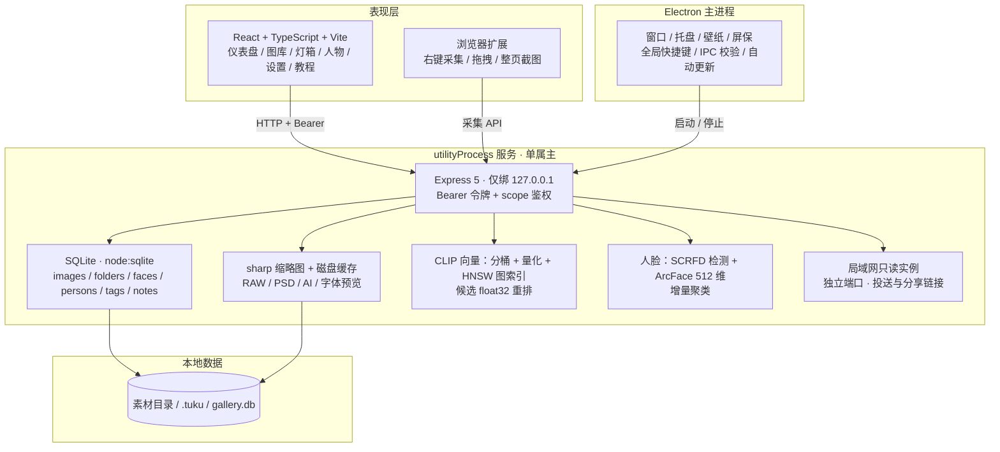
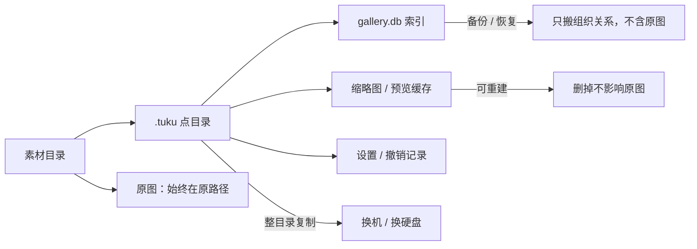
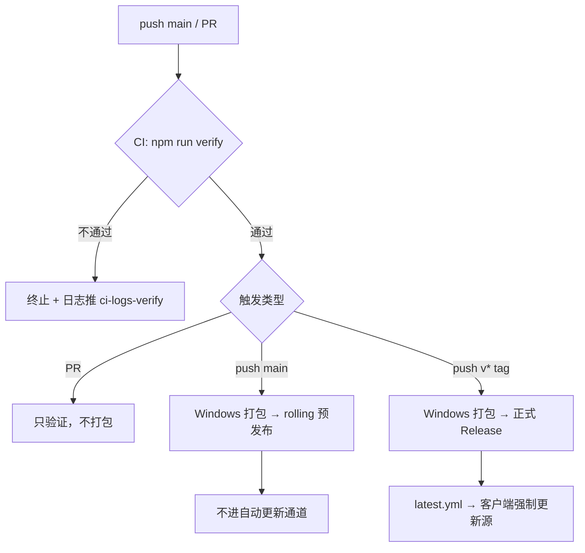

# 图库 TuKu

[](https://github.com/mr-awei/gallery/releases/latest)
[](#1-它是什么)
[](#4-架构与数据流)
[](#11-从源码运行)
[](#12-验证与质量)
[](LICENSE)

**本地优先的图片 / 素材管理工具。** 原图留在你自己的硬盘上，索引、标签、评分、笔记、人脸特征全部存在本地；不注册账号、不上传云端、断网照样能用。

> 仓库同时镜像在 [GitHub](https://github.com/mr-awei/gallery) 与 [Gitee](https://gitee.com/mr-awei/gallery)。自动更新只读 GitHub Releases，Gitee 仅作代码镜像。
>
> **现状 / 评分（百分制：单机 90.9 · 远期目标 87.1 · 当前 17 维 71.2）/ 缺点清单 / 交付顺序见 [`docs/评测与路线图.html`](docs/评测与路线图.html)**；不关心评分、只想知道它能不能用的，看 [`docs/产品介绍.html`](docs/产品介绍.html)。GitHub / Gitee 上请点 **Raw** 或下载到本地用浏览器打开。

---

## 核心指标

| 指标 | 数值 | 说明 |
| --- | --- | --- |
| 设计规模 | 百万级 | worker 池 + 批量事务 + 单次解码 + 增量扫描 |
| 验证覆盖 | 单测 512 · 冒烟 143/143 · 基准 15/15 · 四闸类型 | `npm run verify` 一条命令跑完，CI 同款 |
| 已知缺口 | P1 2 · P2 1 · P3 1（另 6 条已修） | 逐条列在文档 06 节，含代码位置 / 影响 / 成本 |
| 竞品对标 | 单机 90.9 / 远期 87.1 | 13 维第 1（8 竞品）；17 维按目标值 87.1 第 1、按当前进度 71.2 第 3；Eagle 为 82.1 / 71.8 |
| 类型检查 | electron + server + routes + server-lib 全覆盖 | 逐文件 `@ts-check`，由 lint 强制守门 |
| 随包插件 | 4 个官方插件 + 库级启停 + 在线市场 | 能力白名单，独立子进程 |
| 水印 / 相框 | 23 款 / 20 款 | id 稳定，位置三级选择 + 本机字体 |
| 应用内教程 | 173 条 / 23 分类 | `F1` 打开，关键词搜索与命中高亮，随版本更新 |
| 人脸模型 | 191 MB（SCRFD 16.9 + ArcFace 174） | 本地推理，权重按可信 sha256 校验 |
| 安装包 | NSIS · 约 200 MB | `TuKu-Setup-<version>.exe` |

> 「验证全绿」与「没有缺陷」是两件事。前者可以复跑，后者要按代码逐条读 —— 所以这份 README 只写「现在能干什么」，本轮审计的 10 条清单（6 条已修，未修 P1 2 / P2 1 / P3 1）连同代码位置与修复成本摆在 `docs/评测与路线图.html` 第 06 节，不在这里自评清白。

---

## 目录

| | | |
| --- | --- | --- |
| [1 它是什么](#1-它是什么) | [2 下载与安装](#2-下载与安装) | [3 五分钟上手](#3-五分钟上手) |
| [4 架构与数据流](#4-架构与数据流) | [5 功能矩阵](#5-功能矩阵) | [6 竞品对标速览](#6-竞品对标速览) |
| [7 性能基准](#7-性能基准) | [8 快捷键](#8-快捷键) | [9 数据备份与迁移](#9-数据备份与迁移) |
| [10 MCP 与开放 API](#10-mcp-与开放-api) | [11 从源码运行](#11-从源码运行) | [12 验证与质量](#12-验证与质量) |
| [13 打包与发布](#13-打包与发布) | [14 常见问题](#14-常见问题) | [15 边界与说明](#15-边界与说明) |
| [许可](#许可) | | |

---

## 1 它是什么

| | 图库 TuKu | 云盘 / 在线相册 | 纯文件夹 |
| --- | --- | --- | --- |
| 原图位置 | 自己硬盘，不搬不改名 | 服务商 | 自己硬盘 |
| 组织方式 | 多层文件夹 + 标签 + 堆叠 + 智能文件夹 + 人物 | 目录 / 相册 | 目录 |
| 检索 | 文件名 / 标签 / OCR / 颜色 / 语义 / 相似图 / 按人 | 文件名 / 少量 AI | 文件名 |
| 离线可用 | 是 | 否 | 是 |
| 桌面集成 | 壁纸 / 托盘 / 快捷键 / 屏保 | 无 | 无 |
| 百万级 | 是 | 依赖服务端 | 不可用 |

Windows 桌面端（Electron）＋ 本地服务（Node）＋ Web UI，同一套数据三种打开方式。面向**单机创作者**：不做账号体系、不做实时行级云合并，把系统级集成与编辑产出做深。

**不做什么**：账号体系、在线图床、实时协同编辑、跨端行级合并、云同步（只做「同步文件夹 + 版本快照」）。跨平台只保证「能启动并使用图库」，Win32 专属能力（壁纸挂载）明确降级并说明原因。

---

## 2 下载与安装

从 [Releases](https://github.com/mr-awei/gallery/releases/latest) 下载 `TuKu-Setup-<version>.exe`（Windows 10/11，NSIS 安装包）。

- 安装版会接管常见图片 / 视频 / 音频的「打开方式」，双击图片即可用图库打开；便携版不改注册表
- 首次启动选择一个素材文件夹建库，**原文件不动**
- 更新在后台静默检查与下载，下载完成后才提示，由你二选一：**立即安装并重启** / **下次打开时安装**。选了后者，下次启动必须先装完才能用（遮罩只给「安装」和「退出应用」）；安装失败可以选择「本次先继续用」
- AI 能力按需下载模型（语义搜索、去背景、超分运行库、人脸），不下也能用其余全部功能
- 抠图 / AI 超分 / 人脸扫描 / 语义检索这类本地跑模型的功能，开跑前会对着「最低配置」检查一遍 CPU、内存、显卡（AI 超分必须有能跑 Vulkan 的显卡）。不达标会弹出对照表说明差距与门槛依据，配置偏低但仍能试的给「仍然继续」，确定跑不了的不放行。自己的配置与各项最低要求可在「设置 → 画质增强」页底随时查看、重新检测


---

## 3 五分钟上手

| 步骤 | 动作 | 结果 |
| --- | --- | --- |
| 1 建库 | 首次启动选素材目录（如 `D:\图片`） | 库数据写到该目录 `.tuku`，原图不搬不改名 |
| 2 找图 | 顶部搜索框吃文件名 / 标签 / 描述 / OCR；筛选栏叠加类型、星级、颜色、画幅 | 支持 `tag:` `color:` `rating:>=4` `folder:` `kind:video` `is:favorite` 前缀；语义搜索走「关键词 + 向量」混合排序 |
| 3 整理 | 勾选多张 → 底部批量条；拖图到左侧文件夹归档；拖标签到图片打标；按 `F` 快速分类 | 组织关系落库，不移动原文件 |
| 4 认人 | 侧栏「人物」→ 下载人脸模型 → 扫描全库 | 自动按人分组，可改名、合并、删除；同一人的照片一处看全 |
| 5 编辑 | 单击进大图，`←` `→` 翻页，`1`~`5` 打星；「更多」里有裁切、调色、标注、水印相框、擦除修复 | 破坏性编辑会写回原图，操作前请备份 |
| 6 查教程 | `F1`，输入「堆叠」「时间点笔记」「导出」 | 命中处高亮，内容随应用更新、不依赖网络 |

---

## 4 架构与数据流



**四条设计原则**

| 原则 | 落地方式 |
| --- | --- |
| 进程隔离 | 服务跑在 `utilityProcess` 子进程，崩溃不拖死界面；退出前先停服再关窗；主进程不直接引用 `server/db.js` |
| 百万级 | 分页查询 + 覆盖索引 + 缩略图懒加载；导入用 worker 池、批量事务、单次解码、增量扫描；向量检索在 3000~12 万区间走 HNSW，越界退回分桶扫描 |
| 可观测 | 失败必须有提示或日志，禁止 `catch` 之后静默放行：删除失败、模型哈希写入失败、切库后代理失败都要说出来。新增写入路径必须同时给出失败反馈，回归在 `verify` 里 |
| 安全 | 本地 API 令牌每次启动生成；IPC 校验窗口与 origin；`?token=` 仅限 GET；插件是能力白名单而非 OS 沙箱 |

**前端结构**：`App.tsx` 只做编排与 JSX（490 行），状态与弹窗按领域下沉到 `web/src/hooks/` 与 `web/src/app/`：

| hook | 职责 |
| --- | --- |
| `useGalleryList` | 分页、请求代数（丢弃过期响应）、定位后补载、刷新加序 |
| `useStatsAndTags` | 库增长对账、标签树节流刷新、角标计数 |
| `useFolderTree` | 文件夹增删改、进入 / 返回、面包屑 |
| `useSelection` | 多选、框选、全选当前筛选结果 |
| `useLightbox` | 大图导航池、左右翻页、预取 |
| `useSavedFilters` / `useSidebarWidth` / `useAppKeyBindings` | 保存筛选器、侧栏宽度、全局快捷键 |

> 列表的 `refreshGallery` 需要统计的 `refreshStats`，而 `refreshStats` 又依赖列表的 `load` —— 这层循环依赖用 `ref` + `useCallback` 稳定的取值器打通，保证回调身份不随渲染变化（否则 `memo` 与 60s 兜底定时器都会失效）。低频页面全部 `React.lazy` 分包，首屏只加载 `index` 410 kB + `react` 144 kB + CSS 168 kB（约 722 kB，未压缩）；3D 与 Office 预览按需加载，继续瘦身的机会点见文档第 06 节。

---

## 5 功能矩阵

| 分类 | 关键能力 | 教程里搜 |
| --- | --- | --- |
| 浏览与搜索 | 瀑布流 / 网格 / 按文件夹收纳、**时间线（年 → 月 → 日）**、空格快速预览、搜索前缀语法、多维筛选、排序、混合检索（关键词 + 语义）、**时间线 / 清单 / 人物页虚拟滚动**、**EPUB 阅读器（目录 / 正文 / 插图 / 记住读到第几章）** | `搜索语法` `时间线` `快速预览` `筛选` |
| 文件夹与标签 | 多层文件夹、拖拽排序、图标与颜色、封面与锁定、标签分组 / 合并、拖标签打标、批量创建、**批量改信息（评分 / 收藏 / 标签 / 备注）**、保存筛选器、智能文件夹（AND/OR 嵌套） | `文件夹` `标签` `批量改信息` `智能文件夹` |
| 人物 | 本地人脸扫描、按人聚类、改名 / 合并 / 删除、同人阈值三档、质量门槛（糊脸不进聚类）、手动设封面并锁定、按人看图、灯箱内改派 / 移除单张脸 | `人物` `人脸` |
| 堆叠与笔记 | 图片堆叠（建组 / 拖拽并入 / 合并 / 设封面 / 解散）、多条文本笔记、视频音频时间点笔记 | `堆叠` `笔记` `时间点` |
| 整理与查重 | 待整理三视图、MD5 完全重复、pHash 相似重复、库-盘一致性、孤儿缩略图清理、缩略图失败队列（批量重试） | `查重` `失配` `待整理` |
| 编辑与导出 | 裁切、旋转、调色、擦除修复、标注、水印相框、插值增强、**非破坏编辑（裁切 / 旋转 / 调色只记操作链，原图不动）**、视频裁剪 / GIF / WebM、**拼图（模板 + 算法版式，逐格构图、海报文字可调字体字号颜色、原图参与、质量到 100）**、CSV / JSON / HTML 画廊 | `裁切` `水印` `非破坏` `拼图` `导出` |
| 采集与导入 | 本地导入（内容级去重 / 命名模板 / 断点续传 / 同步盘冲突识别 / **进度带速度与剩余时间**）、拖拽投放、剪贴板、网页采集、浏览器扩展、手机扫码投送、**只读分享（有效期 / 密码 / 禁下载）** | `导入` `采集` `扩展` `分享` |
| 壁纸与桌面 | 一键设壁纸、自动换、动态壁纸（视频 / 网页 / GLSL / 粒子 / 音频可视化）、屏保、托盘、全局快捷键 | `壁纸` `动态壁纸` `托盘` |
| AI 与自动化 | CLIP 语义搜索、自动标签与描述、适配度评分、知识库问答、OCR、外部以图搜图、AI 多供应商、API Playground、插件脚本、MCP / API | `语义搜索` `OCR` `MCP` |
| 数据与设置 | 多资源库、同步文件夹快照、备份恢复、**外键约束 + 全库完整性自检**、**API 参考（409 个端点自动生成，可导出 Markdown）**、快捷键自定义、命令面板、日志与诊断、检查更新 | `资源库` `备份` `快捷键` `关于软件` |
| 使用统计 | 每张素材的复制 / 导出次数与最近使用时间，仪表盘「使用统计」榜 | `使用统计` |

> 表格只是索引。**每个功能的完整说明、边界与快捷键都在应用内教程里**（`F1`），并且会随版本更新。

<details>
<summary><strong>展开：逐模块详细说明</strong></summary>

### 图库与浏览

- **三种展示方式自由切换**（顶部视图切换组，记住上次选择）：瀑布流（保留比例）、网格（等高裁切）两种「图片展开」视图，外加「按文件夹收纳」视图。列表视图已移除。
- **图片展开就是全量平铺**：两种图片视图顶部不再插一排文件夹卡片，直接把当前范围内的素材全部铺出来；进入某个文件夹时同样包含其全部子文件夹的素材。
- **按文件夹收纳**（Eagle 式）：同一层级的文件夹各自成组，显示封面 / 名称 / 张数 / 子夹数；点文件夹进入（含全部后代），点箭头就地展开组内图片；组内图片滚到附近才懒加载，拖图到卡片即归档；支持面包屑、按名称找文件夹、全部展开 / 收起、未归档素材一键展开。
- **文件名与路径就是入口**：灯箱顶栏的文件名、详情面板里的库路径与归属文件夹、素材工具箱里的原文件路径都能点 —— 在资源管理器里定位这张图，或直接跳到「只看这一夹」；不用再去右键菜单里翻。
- **页头常驻吸顶**：各页页头（标题、筛选、扫描、批量按钮）滚动时停在顶部；页内的二级吸顶（设置页左栏、整理页任务条、教程页分类）自动让到页头下沿，页头因换行变高也不会错位。
- 搜索框支持白名单前缀：`tag:` `color:` `rating:>=4` `folder:` `kind:video` `is:favorite`，会与筛选栏叠加。
- **混合检索**：语义搜索把关键词命中与向量近邻用 RRF 融合，结果标注每条来自哪一路；engine 字段明确返回 `hybrid` / `keyword` / `loading`，模型没就绪时如实说明而不是假装搜过。
- **时间线视图**：按拍摄时间分「年份 → 月份 → 当天」，左栏年 → 月 → 日三级（月份点开就是那月的每一天，带张数，滚到哪儿高亮到哪儿，点哪天跳哪天）；月头写「379 张 · 3 天」，天头写「2 月 19 日 · 周一 119 张」，滚到哪儿两级标题就吸在顶部（年份不会丢）；单日上千张也按 120 分页，那天点开大图看到的就是当天那一组。**归档口径只有照片自己的时间**：EXIF 拍摄时间（含 EXIF 里的修改时间）优先，其次取文件「修改时间 / 创建时间」中较早的那个，**绝不使用收录进来的时间** —— 拿入库时间当拍摄时间会让 2019 年拍的照片全堆到导入那天。两者都取不到的图先不排入并计数，页内一键「重建拍摄时间」（后台任务、可取消、有进度）会重新读一遍 EXIF 与文件时间。
- **EPUB 当书读**：书进库能看到封面，点开是阅读器 —— 左侧目录（章节标题）、右侧正文与插图，方向键翻章，下次再打开接着上次那一章（进度按素材记在本机）。解析在服务端做，书里的 XHTML 只被转成纯文本块与图片，前端不渲染任何书本自带的 HTML。
- 空格快速预览：鼠标悬停哪张就预览哪张，再按一次关闭；不改变选择状态。
- 多选：勾选、`Ctrl` 加减选、`Shift` 连选、拖拽框选；`Ctrl+A` 全选的是**当前筛选结果**，不只是已加载页。
- 收藏、五星评分、颜色标记都参与筛选；评分同时用于自动换壁纸的最低门槛。
- **万级不卡**：图库主网格与时间线、清单（保存的筛选 / 智能文件夹）、人物全部窗口化渲染（固定窗口 + 占位高度，DOM 节点数不随滚动增长）；主网格配 roving tabindex，整块网格只有一个 Tab 停点，方向键 / Home / End / PageUp / PageDown 可在格子间移动。
- 删除先进回收站，可还原或彻底清除，清空前二次确认。

### 文件夹与标签

- 任意层级文件夹树；拖图归档、拖文件夹移动整枝；同一父级内拖动即排序，顺序持久保存。
- **仪表盘与图库常驻侧栏顶部**，收藏 / 人物 / 清单 / 采集 / 书签以小图标常驻其下，都不参与折叠收纳；只有「待整理 / 保存的筛选 / 标签」分组可折叠，折叠状态与文件夹树展开状态都会记住。
- 灯箱底部缩略图条对 **RAW / 设计稿** 也显示内嵌预览画面，缩略图尚未生成时自动补一次，仍失败才回退文件图标。
- 侧栏右边界平时就可见，中间的小握把提示可左右拖动调宽，双击复位。
- 文件夹可以设 **emoji 图标 + 主题色**，侧栏树与「按文件夹收纳」视图都会显示；封面可手动指定，锁定后防误删。
- 标签支持分组、改色、重命名、合并、别名；**把侧栏标签拖到图片卡片或列表行**即可追加打标。
- **批量改信息**：多选后一次改评分 / 收藏 / 标签（添加 · 移除 · 替换）/ 备注，走单个事务（上限 5000 张），整批只记一条撤销记录 —— 一次 `Ctrl+Z` 全回滚。改标题仍归「批量重命名」，不在这里混着做。
- 批量创建：标签与子文件夹都能一行一个批量建，同名自动跳过，空标签也会立刻出现在列表里。
- **保存筛选器**：把搜索词 + 筛选条件 + 当前文件夹存成入口；悬停条目可以改名、**用当前条件覆盖更新**、删除。
- **智能文件夹**：把「最近 7 天 + 红色 + 4K」这类组合条件存为常驻集合，可预览并对命中图片批量打标。规则支持**分组与 AND / OR 嵌套**，旧规则自动视为单个 AND 组，行为不变；空分组会被忽略（否则 OR 会捞全库）。

### 人物

- **全本地推理**：SCRFD det_10g 负责检测（含 5 点关键点），ArcFace w600k_r50 出 512 维特征；两张 ONNX 合计 191 MB，照片不出本机。
- 扫描是**增量**的：扫过的素材打标记，下次只处理新增；进度落任务中心，可随时停止、可重跑。
- 自动聚成「人物」：同人阈值默认 0.42，可在扫描前选「严格 0.50 / 标准 0.42 / 宽松 0.35」；同一张脸换个尺寸、旋转、重新压缩仍能认出来（特征余弦实测 0.94~1.00）。
- **门槛分三层**：能显示（`keep`）< 能进人物（`cluster`）< 能当封面（`coverRank = 质量 × min(1, facePx/96)^0.5`）。糊脸、侧脸、小图不会被推成人物封面；整簇平均质量过低会被解散，不留下「一个模糊的人」。
- 人物可改名、合并、删除；删除只清人脸记录，图片与标签不受影响。封面可在照片墙悬停时**手动指定并锁定**，之后扫描 / 清理 / 重建都不会按分数换掉它。
- **灯箱里能看到「这张图有谁」**：显示人名，可把某张脸改派到另一个人物，也可直接移除；无人脸时整块不渲染。这一格用的是自绘下拉（带搜索框、弹层最小 200px），库里有上千个人物时按名字直接定位。
- 模型走随包可信哈希清单：安装前后都比对 sha256，不符即删包报错，不会静默加载被替换的权重。

### 堆叠与笔记

- 多选建堆叠，评分最高的当组主（封面）；一张图只属于一个堆叠。
- **拖图到组主卡片上直接并入**；桌面端默认拖拽是「拖出成文件」，按住 `Alt` 拖才是应用内叠堆。
- 卡片显示 `⧉ 张数`；查看器里可设封面（不按评分，点谁是谁）、移出、**并入其他堆叠**、解散。
- 拖走组主时，原组会自动提升剩下最早的一张当组主，不会散架。
- 笔记：每张多条，独立于单条「我的备注」；视频 / 音频可以把笔记**钉在当前播放时间**，点时间码直接跳回。
- 统计口径统一：堆叠成员不单独计数，张数、体积、标签云、待整理、文件夹张数都按「一组算一条」。

### 整理与查重

- 待整理三视图：未分类 / 无标签 / 未评分，处理完计数实时减少。
- 完全重复按 MD5；相似重复按感知哈希（pHash）分桶 + 汉明距离，裁切压缩调色过的同一张图也能聚类。
- 库-盘一致性检查：应用外改名 / 移动 / 删除导致路径失效时，列出失配项并尝试重新关联。
- 孤儿缩略图清理：先 `dryRun` 出清单再执行，空库或目录异常时直接拒绝。
- **缩略图失败队列**：待生成 / 生成中 / 累计失败 / 库里缺图四个数字，失败项带原因（文件缺失、解码失败、格式不支持）；支持**单张重试**（200 条里只有一张被临时占用时不必整批重跑）、**一键重试全部**与**清空失败明细**。
  > 重试只重新排队生成缩略图，不动原图；文件确实不在盘上时，重试会继续失败并把原因写成「文件缺失」。

### 编辑与导出

- 裁切：自由比例 + 常用比例，默认按**通用显著度**定位焦点（不是只找人脸）。
- 旋转 / 翻转、参数化调色、全自动调色（不压暗、不压平反差、饱和度只增）。
- **非破坏编辑（设置里可选开）**：打开后裁切 / 旋转 / 调色只往 `edit_ops` 记操作链，原文件一个字节都不动；缩略图 / 预览 / 原图 / 下载 / 导出 / 插件接口 / 局域网分享都按操作链渲染，成品单独缓存，缓存键带操作链版本号。灯箱「更多 → 非破坏编辑」可看清单、**应用到底片**或**整体还原**，每加一步都是独立撤销记录。增强 / 超分 / 擦除这类「结果就是新像素」的动作仍写回原图。
- 擦除修复：内容感知扩散，适合划痕 / 水印 / 电线 / 小物件；大图在 1200 长边工作副本上修复再映射。
- 标注：矩形、箭头、文字、序号、马赛克，坐标按原图比例保存。
- 水印 / 相框：23 款水印 + 20 款相框，位置三级选择 + 本机字体。
- 画质增强是**插值放大**，界面与文档都如实标注，不包装成 AI 超分。
- 视频：首尾裁剪可保存区间；导出 GIF（纯 JS GIF89a）或 WebM（MediaRecorder），不依赖 ffmpeg。
- 导出：单张下载、按文件夹结构导出、CSV / JSON、单文件 HTML 画廊；导出会累加使用统计。
- **拼图**：三连海报等模板与网格 / 对齐 / 满版拼贴 / 漫画 / 海报等算法版式，**所有版式都能逐格调焦点与缩放**（滚轮缩放、拖拽挪位、双击复位，缩到「整图刚好装进格子」就停并提示）；参与拼图的是**原图**，质量档到 100。海报文字（主标题 / 副标题 / 演职员条）可选**本机字体、字号倍率、标题颜色**，静止时直接把服务端成品铺在画布上，看到的字与导出的字是同一层。
- **反向导出 Eagle 库**：把当前库写成 Eagle 4 的 `.library`（原图 + 文件夹层级 + 标签 + 星级）。数据出口里先显示「张数 · 体积 · 文件夹数」再决定要不要导，导出走后台任务 —— 可看进度、可停止、结束进任务历史，取消或失败会删掉本次写出的半成品目录。

### 采集与导入

- 本地导入递归扫描，跳过隐藏与垃圾目录（含同步盘临时文件），已入库文件增量跳过；导入用 worker 池 + 批量事务，进度条实时显示**每秒张数与预估剩余时间**。
- **导入时内容级去重**：先用文件大小快筛，只对同字节数的候选算 MD5，命中即跳过，并回报「跳过 N 张重复」。
- **断点续传**：导入进度落 `import-job.json`，中途退出后重启按「已中断」展示，继续即重跑增量扫描（未变文件自动跳过）。
- **同步盘友好**：识别 `*sync-conflict*`、`~$*` 等冲突副本，照常入库但单独计数，避免悄悄变成两份。
- 拖拽投放（窗口中央圆盘）、剪贴板粘贴图片或图片地址；手动采集不套 30KB / 800px 这类爬虫门槛。
- 网页采集：10 个源（Bing / 百度 / 搜狗 / 360 / 堆糖 / 微博 / Wallhaven / 豆瓣 / 贴吧 / Wikimedia），可配质量门槛、页数与代理，记录来源 URL；任务可断点续采。
- 浏览器扩展：右键采集（图片 / 本页全部 / 整页截图）、拖拽悬浮球；整页截图逐屏拼接，最多 24 屏 / 16000px 高，超出会截断并提示。
- 手机扫码投送：同一 Wi-Fi 下扫码上传，独立端口与令牌，默认关闭。端口优先固定 `53317`（被占用才由系统分配），二维码内容与页面显示的地址严格同源；多网卡可手动选择，设置页提供「本机连通性自检」与防火墙 / 同网排查指引。轮换令牌不会重启服务、不会换端口。手机页可选目标文件夹（按 id 挂载，纯虚拟夹也能落进去），路径方式 `?folder=a/b` 仍兼容。
- **只读分享链接**：生成 30 分钟 ~ 1 天的临时链接，手机 / 另一台设备可浏览、搜索当前库，不能上传；可选**访问密码**与**禁止下载原图**，列表直接标出这两项状态。令牌只存服务端内存，重启或「全部撤销」立即失效。

### 壁纸与桌面

- 一键设 Windows 壁纸；自动换支持间隔、范围、顺序、最低评分与「不喜欢」排除。
- 动态壁纸：相册轮播、本地视频、网页、GLSL 着色器、交互粒子、音频可视化；参数滑块实时生效。
- 屏保按系统空闲时间全屏播放，键鼠一动立即退出，全屏游戏不打扰。
- 托盘常驻：换一张、收藏、不喜欢、暂停、打开主窗口；托盘菜单顶部保留「上次操作」文字。Windows 系统 toast 不可靠，操作反馈走自绘提示窗。
- 全局快捷键不开主窗口也能换壁纸。

### AI 与自动化

- 语义搜索：CLIP 图文向量检索；向量数在 3000~12 万之间时走 HNSW 图索引，候选按 `max(k*3, k+8)` 多取后做 float32 精确余弦重排；模型未下载时明确显示不可用，不假装搜过。
- **AI 夜间批处理**：语义索引与人脸扫描的缺口可在设置里指定时段（默认 02:00–06:00，支持跨午夜）串行补算；只补缺口、前台一忙就让路，也不会在半夜偷偷下模型权重。
- 自动标签与描述、适配度评分（可解释指标，不是玄学打分）、知识库问答（回答带引用图片）。
- OCR：调用 Windows 内置引擎，识别结果可被搜索命中。
- 以图搜图：SauceNAO（需自填 Cookie）、Google Lens（需公网地址）、TinEye；失败会说明卡在哪一步。
- **AI 多供应商**：OpenAI / 兼容接口 / 本地 Ollama 各存一份配置，可同时存在并一键切换；激活时回写顶层字段，旧调用点无感；密钥只回掩码。
- **API Playground**：在设置页里选接口、填参数、发送，直接看状态码、耗时与 JSON。
- **批量动作（Actions）**：把打标签、改标题、移文件夹、评分、OCR、AI 描述 / AI 指令串成一条动作，对选中素材一次执行（上限 500 张）。三个配套能力：**执行条件**（评分 / AI 匹配度 / 标签 / 关键词 / AI 关键词 / 收藏 / 画幅，AND·OR，与智能文件夹同一套规则）、**逐图预演**（确定性步骤给出「改前 → 改后」，AI / OCR / 插件步骤如实标注无法预演，全程不写库）、**一键撤销**（执行即写操作日志，按快照还原字段并摘掉本次新加的文件夹）。
  > 条件编辑器与智能文件夹共用 `ConditionEditor`，字段对齐到同一套白名单 —— 后端认得的条件，界面上一定填得出来，不再出现「接口支持、面板没口」。
- 插件：`plugins/<id>/plugin.json` + ESM 入口，独立子进程、只拿素材快照，写库需声明 `image:write` 且只允许 tags / note / rating / favorite。**能力白名单，不是 OS 沙箱**。随包 4 个官方插件（前缀打标 / 画幅与分辨率 / 媒体类型 / 备注补日期），可在设置页**库级启用 / 停用**（停用后执行被明确拒绝），并支持插件市场在线安装；主题包可导出 / 导入 `.tuku-pack`。
- MCP 与 `/api/v1`：见第 10 节。

### 数据与设置

- 多资源库：独立目录 + 独立 `gallery.db`，可分别放在不同硬盘；同一时刻只有一个激活。
- **资源库密码锁**：切换器里给某个库单独设密码，切过去要输密码，其它库不受影响。锁着的库，服务端对图片 / 统计 / 文件夹 / 标签一律回 423（界面整页停在解锁屏），只放行解锁、切库、读设置。解锁状态按库记：重启或切到别的库后重新锁上；也能「立即上锁」一键封上。**这是访问口令，不是磁盘加密** —— `gallery.db` 与缩略图不加密，把库目录整个拷走仍能被别的工具读出来；要的是「别人打开软件看不到」，它就够。
- 跨库共享：微博 Cookie、网络代理、AI 接入配置；AI 总开关是库级的。
- 同步文件夹：库索引既可「备份 / 恢复」，也可在同步盘里显式发布 / 拉取快照，冲突明确报出而不是静默覆盖。
- 备份导出库索引与设置（不含原图）；恢复时会按新根目录重映射路径，缺失项单独列出。
- **外键约束**：库连接默认开启 `PRAGMA foreign_keys=ON`，删素材时关联的标签 / 文件夹 / 人脸 / 笔记随外键级联清掉；老库首次打开自动迁移并先留一份 `.bak-fk` 备份。维护页可跑「引用完整性自检」，列出并清理历史遗留的孤儿行。
- **API 参考**（设置 → API 参考）：从真实路由表自省生成 409 个端点，按分组列出方法 / 路径 / 参数 / 鉴权方式，支持关键词过滤；`/api/docs.md` 一键存成 Markdown。接口改了清单就跟着变，不会像手写文档那样过期（缺的是各语言请求示例，见文档第 06 节）。
- 快捷键可自定义，`Ctrl+K` 命令面板搜命令直接跳页面。
- **界面语言**：只提供简体中文，不设语言切换；教程、设置、提示与错误信息均为中文。
- **下载中心**（设置 → 运行状态 → 下载中心）：超分 / 抠图 / 人脸 / 语义四类共 16 项模型集中在一页，显示是否已装、实际占盘（stat 磁盘，不用清单里的预估）、可清理体积；每行支持下载、取消、校验、重新下载、删除。进度走 SSE，下载中实时更新，不用反复刷新。状态以磁盘为准，`sizeHint` 只用于「未装时显示约多少 MB」。
- 日志与崩溃转储可在「设置 → 关于软件 → 目录与诊断」一键打开，同页还能复制完整诊断信息；启动时自动清理 7 天前的转储。
- **关于软件**（设置最后一个分区）：版本号与安装形态、检查更新与下载进度、开机自启与「启动时自动检查更新」开关、Electron / Chromium / Node / V8 与系统架构、程序数据 / 日志 / 崩溃转储目录、帮助与反馈链接、开源组件清单。版本与环境一律由主进程 `app-info` 提供，前端不硬编码。

</details>

---

## 6 竞品对标速览

同一批 8 个竞品、17 个维度，口径 2026-11-16。单机基准只算已实现的 13 维；云与多端、协作社区、多语言、跨平台是四项**远期目标**，按“目标值”另算一档：

全部百分制，同一套权重直接读数（不再用“10 分制小数”，避免把 90 分误读成 9 分）：

- **单机基准**（13 维 100 分）：**90.9 分，8 竞品第 1**
- **远期目标**（17 维，四项按 80 / 60 / 90 / 85 计）：**87.1 分，第 1**；同一口径按今天的进度是 **71.2 分，第 3**；中期目标 76.4 分，第 2

逐项证据、10 条缺点与交付顺序见 [`docs/评测与路线图.html`](docs/评测与路线图.html)；面向普通用户的功能介绍见 [`docs/产品介绍.html`](docs/产品介绍.html)。

| 产品 | 单机基准 | 远期 17 维 | 定位 | 它最强 / 最弱 |
| --- | --- | --- | --- | --- |
| **图库 TuKu** | **90.9（1）** | **71.2 → 87.1**（第 3 → 第 1） | 本项目 | 强：自动化 / 桌面集成 / 数据出口；远期：云、协作、多语言、跨平台 |
| Eagle 4 | 82.1（2） | 71.8 | 商业素材库 | 强：格式预览深度 / 手感 / 生态；弱：无脚本接口 / 无本机 AI |
| Immich | 72.9（3） | 78.2 | 开源自托管相册 | 强：多端 / 多用户 / 同步；弱：设计稿与桌面集成 |
| Billfish | 69.6（4） | 63.4 | 国产本地素材 | 强：上手快；弱：AI / 自动化 / 格式 |
| PhotoPrism | 68.2（5） | 70.5 | 开源自托管照片 | 强：检索 / 自动整理；弱：编辑 / 导入体验 |
| Pixcall | 67.5（6） | 68.8 | 轻量素材管理 | 强：轻快；弱：格式与开放能力 |
| Bridge | 66.7（7） | 65.8 | Adobe 配套 | 强：贴合 Adobe 流程；弱：库能力 |
| XnView MP | 59.2（8） | 55.0 | 看图工具 | 强：格式与轻量；弱：组织与检索 |

| 维度 | 权重 | TuKu | Eagle | Immich | 结论 |
| --- | --- | --- | --- | --- | --- |
| 收集与导入 | 8 | 93 | 85 | 75 | 10 个采集源 + 扩展 + 剪贴板，领先 |
| 组织与元数据 | 10 | 94 | 94 | 80 | 与 Eagle 打平；相册类缺设计稿字段 |
| 浏览与检索 | 12 | 95 | 85 | 85 | FTS5 trigram + 语义 + 颜色 + 相似图；瀑布流坐标增量追加、只查可见段 |
| 编辑与产出 | 8 | 90 | 75 | 60 | 非破坏 edit_ops + 撤销栈，领先 |
| 格式与媒体 | 7 | 86 | 92 | 65 | 覆盖最广，但字体 / 3D / Office 预览浅于 Eagle |
| AI 能力 | 8 | 91 | 65 | 80 | 本机 CLIP + 人脸聚类 + HNSW，全离线；推理走显卡，索引缺口可夜间串行补算 |
| 自动化与开放 | 8 | 94 | 65 | 55 | REST + 11 个 MCP 工具 + 插件沙箱，最大优势；文档自带三语言示例 |
| 桌面与系统集成 | 7 | 93 | 80 | 30 | 热键 / 托盘 / 动态壁纸 / 拖出，最大优势 |
| 性能与规模 | 9 | 88 | 88 | 85 | API p95 个位数毫秒，DOM 与布局计算都不随库增长；百万级未验收 |
| 数据安全与可恢复 | 8 | 90 | 80 | 85 | 备份校验 + 双栈撤销 + 外键 + 完整性自检 |
| 稳定性与工程质量 | 7 | 89 | 82 | 85 | 契约 45/52 + 512 单测 + 143 冒烟 |
| 易用性与界面 | 5 | 85 | 92 | 75 | 25 个弹窗统一焦点陷阱与 aria；主网格 roving tabindex + 方向键已补 |
| 文档与交付 | 3 | 85 | 85 | 75 | 173 条内置教程 + `/api/docs` 自动生成，但安装包仍未签名 |

> 本地榜领先 Eagle 8.8 分，靠自动化、桌面集成与数据安全；全能榜落后 Immich 7.0 分、已越过 PhotoPrism，差的是云同步（15 / 9）、协作社区（20 / 8）、多语言（5 / 5）、跨平台（20 / 4）——**这四项是产品决策，不是打磨能补的**。真正该修的短板：安装包未签名、字体与 3D 预览深度、跨平台仅 Windows；剩下两项打磨做完约 5–7 周，本地榜到 **91.2**、全能榜当前分到 **71.4**。

---

## 7 性能基准

`npm run bench` 在临时库灌数据后打真实 HTTP 接口取 p50 / p95；另跑两条不经过 HTTP 的路径：调色预览（`renderPixels`）与 CLIP 向量检索。缺模型权重 / 无浏览器时明确跳过，不会假绿。

以下为 2026-11-09 `npm run bench:quick`（2 万行）实测：

| 场景 | p95 | 门槛 | 结果 |
| --- | --- | --- | --- |
| 列表首页 `pageSize=100` | 7 ms | 200 ms | PASS |
| 列表深页 `page=199` | 10 ms | 400 ms | PASS |
| 关键词搜索 | 13 ms | 500 ms | PASS |
| 标签筛选（10% 命中） | 12 ms | 500 ms | PASS |
| 收藏筛选 | 5 ms | 300 ms | PASS |
| 标签列表（缓存） | 4 ms | 300 ms | PASS |
| 标签列表（重算） | 13 ms | 1200 ms | PASS |
| 统计（缓存） | 3 ms | 150 ms | PASS |
| 统计（冷查询） | 37 ms | 1500 ms | PASS |
| 调色预览 720 长边（拖动帧） | 22 ms | 25 ms | PASS |
| 调色预览 1600 长边（停手帧） | 70 ms | 80 ms | PASS |
| 调色预览 4000×3000（原图） | 571 ms | 仅记录 | — |
| CLIP 2 万向量全库扫描 | 45 ms | 300 ms | PASS |
| CLIP 文本塔编码 | 6 ms | 500 ms | PASS |

百万行历史实测（2026-11-08，10/10 达标）：列表首页 30 ms、深页 253 ms、关键词搜索 406 ms、标签筛选 309 ms、收藏筛选 35 ms、标签列表缓存 4 ms、统计缓存 4 ms。历史瓶颈已收口：`/api/tags` 797→4 ms（倒排表聚合 + 指纹缓存）、`/api/stats` 冷查询 2562→1810 ms 并改为快照。

> **CI 口径**：共享 runner 的单核时延抖动大，`scripts/bench.mjs` 在 `CI=true` 时把绝对门槛放宽 3 倍并打印 `CI×3`，只拦数量级回退；本地与专用压测机仍按原门槛严格判定。

---

## 8 快捷键

主窗口的全局键位都可以在设置 → 快捷键里改；大图 / 标注 / 工作台内部是场景专用键位。

| 键 | 作用 | 键 | 作用 |
| --- | --- | --- | --- |
| `Ctrl+K` | 命令面板（搜命令 / 页面 / 图片） | `Ctrl+F` | 聚焦搜索框 |
| `Alt+F` | 筛选器搜索 | `Space` | 快速预览鼠标下的素材 |
| `Ctrl+A` | 全选当前筛选结果 | `Delete` | 删除选中（进回收站） |
| `Ctrl+Z` | 撤销最近一次写入 | `F1` | 打开使用教程 |
| `?` | 快捷键速查面板 | `F` | 快速分类（卡片上是收藏） |
| `1` ~ `5` / `0` | 大图里打星 / 清除 | `←` `→` | 大图翻页 |
| `Esc` | 关闭大图 / 弹窗 / 清除选择 | | |

---

## 9 数据备份与迁移



- 库索引、缩略图、笔记、撤销记录都在素材目录的 `.tuku` 下；**原图始终在原路径**。
- 换机 / 换硬盘：把整个素材目录（含 `.tuku`）复制过去，再在应用里重新指定即可。
- 只想搬组织关系：用「备份 / 恢复」导出库索引与设置（不含原图）；恢复会按新根目录重映射，并把缺失文件单独列出来。
- 数据库升级在事务里执行、失败整体回滚，并会先留一份 `gallery.db.bak-v<版本>-<日期>` 快照。
  > **快照写不出来就不迁移**：结构迁移前若 `VACUUM INTO` 失败（磁盘满、权限、文件被占用），启动会直接中止并说明原因，库结构一个字段都不动 —— 不留「以为有回退点、其实没有」的局面。只有当库是被更高版本创建（降级安装）时，才退化成「告警 + 继续」，因为那种情况不动结构。
- 旧版本打开新结构库会告警并要求先备份。
- 缩略图按需生成，删掉可重建，不影响原图。
- **文件出口必须允许点目录**：`.tuku` 以点开头，静态服务需 `dotfiles: allow`，否则缩略图全部 404。

```
素材目录/
├── .tuku/                 库数据（随素材目录一起搬走）
│   ├── gallery.db         SQLite 索引（多库各自独立）
│   ├── thumbs/            缩略图与预览缓存（可重建）
│   └── settings/          库级设置
├── 设计稿/                原图，不搬不改名
└── 照片/
```

---

## 10 MCP 与开放 API

`npm run mcp` 启动 stdio MCP 服务（零依赖，JSON-RPC 2.0），把图库能力暴露给 Claude Desktop、Cursor、CodeBuddy 等客户端。

| 工具 | 作用 |
| --- | --- |
| `search_images` | 按关键词 / 条件搜图 |
| `set_wallpaper` / `set_wallpaper_by_query` | 指定图片或一句话换壁纸 |
| `next_wallpaper` / `current_wallpaper` | 换下一张 / 查当前 |
| `favorite_current` / `dislike_current` | 收藏 / 不喜欢当前壁纸 |
| `list_favorites` | 列出收藏 |
| `list_smart_folders` / `apply_smart_folder` | 列出并应用保存的筛选器 |

本地 HTTP 接口：

- `/api/v1` 是稳定契约，`Authorization: Bearer` + `read` / `write` / `ingest` 三级 scope
- 自带 OpenAPI 3.0 文档（`/api/v1/openapi.json`）、每分钟 120 次限流、审计日志不含令牌明文
- 附加令牌写在用户数据目录 `api-tokens.json`，或用 `TUKU_API_SCOPE_TOKENS` 注入
- 本地 API 的启动令牌每次启动重新生成；`?token=` 仅允许 GET，写操作必须走 header
- IPC 校验 `sender` 与同源；浏览器扩展采集端点只放行白名单扩展 ID
- 设置页的 **API Playground** 可以直接调这些接口，不必另装 curl 客户端

---

## 11 从源码运行

需要 Node.js ≥ 22.5（`node:sqlite` 为实验特性，启动时的 `ExperimentalWarning` 属正常）。

```bash
npm ci
npm run dev        # 后端(3001) + Vite(5173) + Electron 一起起
npm run dev:web    # 只起后端与网页（浏览器打开 5173 调试）
npm start          # 只跑本地服务（默认 3001），用已构建的 dist/web
```

### 目录结构

```
electron/          Electron 主进程、预加载桥、壁纸、托盘、自动更新（全部 // @ts-check）
server/            本地服务：Express 路由、SQLite、缩略图、导入、采集、AI、人脸、MCP
  routes/          按领域拆分（organize / stats / collections / export / lan / face …）
  lib/             可复用逻辑（query / tags / stacks / clip / hnsw / face-math / lan …）
  model-pins.json  模型与运行库的可信 sha256 清单（随包只读）
web/src/           React 前端
  hooks/           列表 / 统计 / 文件夹 / 选择 / 灯箱 / 键位等 8 个 hook
  pages/           仪表盘、图库、人物、采集、清单、教程、设置…
  components/      卡片、灯箱、对话框、文件夹卡片…
  lib/             快捷键、路由、视频取帧、教程内容（tutorial-content.ts + tutorial/extra-*.ts）
plugins/           4 个随包官方插件（plugin.json + ESM 入口）+ _market 索引
extension/         浏览器扩展（随安装包以 extraResources 分发）
assets/samples/    示例素材（随安装包分发到 samples/）
test/              单测（node:test，469 例）
scripts/           冒烟、基准、发布、维护脚本；lint.mjs 负责类型闸守门
docs/              评测与路线图.html（评分 / 缺点 / 交付顺序）、产品介绍.html（面向用户的功能介绍）
```

### 常用脚本

| 脚本 | 说明 |
| --- | --- |
| `npm run build` | 构建前端到 `dist/web` |
| `npm run typecheck` | 四段 tsconfig 全量类型检查（Web / Node / 纯函数库 / server-lib） |
| `npm run lint` | ESLint + 自定义语法检查 + 类型闸 pragma 校验 |
| `npm run unit` | Node 原生 test runner，512 例 |
| `npm run smoke` | 接口冒烟（会起临时服务），143 项 |
| `npm run bench` | 性能基准：临时库灌 20 万行，打真实接口取 p50 / p95；另含调色预览与 CLIP |
| `npm run bench:quick` | 2 万行快速版（约 7 秒，已接入 `verify`） |
| `npm run verify` | lint + typecheck + unit + smoke + bench:quick + 手动脚本登记检查（CI 同款） |
| `npm run dist` | 构建并打 Windows 安装包（`release-build/`） |
| `npm run mcp` | 启动 MCP stdio 服务 |
| `npm run import` | 命令行导入本地目录 |
| `npm run pin-models` | 把已验证的模型 / 运行库哈希写进 `model-pins.json` |

---

## 12 验证与质量

| 环节 | 命令 | 本次结果 |
| --- | --- | --- |
| 静态检查 | `npm run lint` | 249 个文件，0 错误 / 0 告警；`electron/**`、`server/lib/**`、`server/routes/**` 缺 `@ts-check` 直接失败 |
| 类型 | `npm run typecheck` | Web / Node / 纯函数库 / server-lib 四套 tsconfig 通过 |
| 单测 | `npm run unit` | 512/512（鉴权、颜色搜索、CLIP 索引、HNSW 召回、人脸几何、RAW/PSD、模型清单、插件市场、名称模板、LAN、回收站、相似检索、非破坏几何、外键级联、接口文档、夜间时段、瀑布流布局等） |
| 冒烟 | `npm run smoke` | 143/143 |
| 基准 | `npm run bench:quick` | 15/15 达标 |
| 人工清单 | `npm run verify:manual` | 11 个脚本登记齐全，实跑 1 个无头脚本 |

`npm run verify` 是发版前的唯一准绳，CI 跑同一套脚本。

> **全绿不等于无缺陷。** 这套命令只覆盖「已经写进测试的路径」，`server/routes/**` 的直接测试仍缺失（下次复审重点）。当前 4 条未修缺口（P1 2 / P2 1 / P3 1），另有 6 条已落地保留为回归项，逐条列在 `docs/评测与路线图.html` 第 06 节（缺点）与第 08 节（提分方案）；文档里的统计数字由 `verify` 末尾自动回写，不再手抄。

**类型闸怎么工作**：`tsconfig.node.json` 的 `checkJs` 仍是 `false` —— 全局打开会把被 import 的 `server/*.js` 整片拖进来，噪音无法按目录收敛。所以采用**逐文件 `// @ts-check`**：

| 范围 | 状态 |
| --- | --- |
| `web/src`（TS） | `tsconfig.json` 原生类型检查 |
| `electron/**` | 28 个文件全部 `@ts-check`，由 `tsconfig.node.json` 检查 |
| `server/lib/**` | 全部 `@ts-check`，另有 `tsconfig.server.json` 深闸 |
| `server/*.js`、`server/routes/**` | 全部 `@ts-check` |
| 纯函数库 | `tsconfig.lib.json` |

> 漏写 pragma = lint 失败，所以「新文件忘了开检查」不会悄悄发生。这道闸值钱的地方在于：它抓的是那种**跑起来不报错、结果全错**的缺陷 —— 例如引用了不存在的 Electron API（电池判定恒为真）、联合类型没被收窄（一条本该 `skipped` 的分支当成成功走完）。这类问题测试很难覆盖，类型检查一读就出来。

> **CI 门槛口径**：GitHub Actions 是共享 runner，单核时延波动大，绝对 p95 门槛在 CI 中放宽 3 倍（输出里会标 `CI×3`）。CI 失败时，`verify-out.txt` 会推到 `ci-logs-verify` 分支，`build-out.txt` 推到 `ci-logs` 分支，本地 `git fetch origin <分支> && git show origin/<分支>:<文件>` 即可取日志（匿名 API 读不到 Actions 日志）。

---

## 13 打包与发布

```bash
npm run dist -- --publish never      # → release-build/TuKu-Setup-<version>.exe
```

- NSIS 安装包，`build.nsis.artifactName` 固定 `TuKu-Setup-${version}.exe`；`extraResources` 带上浏览器扩展与示例素材
- `asarUnpack` 展开 sharp / onnxruntime / jpegtran 等原生模块及其运行时 JS 依赖
- 安装版注册常见媒体格式打开方式；便携版不改注册表
- 输出目录被占用时换一个：`--config.directories.output=build-out`



| 触发 | 结果 |
| --- | --- |
| PR | 只跑 lint + typecheck + unit + smoke |
| push `main` | 安装包挂到固定 tag `rolling` 的**预发布**，不进自动更新通道 |
| push `v*` 标签 | 构建安装包 → 正式 Release → 成为客户端**强制更新源** |

### 发版步骤

```bash
# 1. 升版本（不自动打 tag）
npm version patch --no-git-tag-version
# 2. 全量验证
npm run verify
# 3. 提交
git add -A && git commit -m "feat: vX.Y.Z ..."
# 4. 打 tag 并点名推送（不要用 --tags）
git tag vX.Y.Z
git push origin main vX.Y.Z      # GitHub → 触发 CI 出正式 Release
git push gitee main vX.Y.Z       # Gitee → 仅代码镜像
# 5. 本地出包
npm run dist -- --publish never
```

> **不要用 `git push --tags`**：本地若残留陈旧的 `rolling` tag，远端同名 tag 由 CI 每次重建，整条命令会报 `already exists` 并失败。点名推具体 tag 最稳。
>
> **tag 构建失败会断掉强制更新源**：`releases/tags/vX.Y.Z` 会 404、`releases/latest` 停在上个版本。修完 CI 后把 tag 前移到修复提交并 `git push -f origin refs/tags/vX.Y.Z` 重新触发，`workflow_dispatch` 只出 rolling 预发布，不能替代。
>
> **本地打包环境**：先删净整个 `release-build/` 输出目录（避免 builder 内部 rm 被安全软件或删除守卫拦截）；国内网络设 `ELECTRON_MIRROR=https://npmmirror.com/mirrors/electron/`；360「主动防御」服务（`ZhuDongFangYu`）可能锁住 `default_app.asar`，出现 `EBUSY` / `EPERM` 时再关闭它。CI 打包必须显式 `--publish never`。

### 产物核验清单

1. `app.asar` 顶层含 `express` / `call-bind-apply-helpers` / `server` / `electron` / `plugins` / `dist`，无 react 三件套
2. `app.asar.unpacked` 含 onnxruntime-node / onnxruntime-common / sharp 的原生二进制
3. `ELECTRON_RUN_AS_NODE=1 TuKu.exe -e "require(...)"` 实测原生模块可加载
4. 隔离 `userData` 启动，日志出现 `[desktop] 加载 http://127.0.0.1:<port>` 与托盘就绪

---

## 14 常见问题

<details>
<summary><strong>Q：断网还能用吗？</strong></summary>

能。检查更新失败不锁界面，只是暂时不升级。所有素材、索引、教程、人脸特征都在本地。
</details>

<details>
<summary><strong>Q：卸载或删库会删我的图片吗？</strong></summary>

不会。卸载、更新、删除资源库都只动程序与库索引；原图在素材目录里。回收站的彻底清除是否删原文件，取决于设置里的删除行为。
</details>

<details>
<summary><strong>Q：有的图显示不出来？</strong></summary>

大概率是文件在应用外被改名 / 移动 / 删除，或库目录换了盘符。先跑「库-盘一致性检查」重新关联，别急着重新导入（重导会丢评分与标签）。
</details>

<details>
<summary><strong>Q：为什么堆叠后总张数变少了？</strong></summary>

堆叠按一条统计：3 张同组素材在图库里显示 1 条。展开堆叠能看到全部成员；解散后张数恢复。
</details>

<details>
<summary><strong>Q：拖拽为什么没反应（桌面端）？</strong></summary>

桌面端默认拖拽是「拖出成文件」（可以拖进微信 / PS）。应用内叠堆请按住 `Alt` 拖；手动排序模式下拖拽是调整顺序。
</details>

<details>
<summary><strong>Q：人脸模型多大？会不会上传我的照片？</strong></summary>

191 MB（检测 16.9 MB + 特征 174 MB），下载一次即可，之后完全离线。照片只在本机解码与推理，特征与框存在你的 `gallery.db` 里，不联网、不上传。删掉模型目录随时可以重下。
</details>

<details>
<summary><strong>Q：同一个人被分成了两组（或者两个陌生人被并在一起）？</strong></summary>

人物页可以合并两组，也可以删掉错误的人物。想整体重来就去「清空并重扫」并换一档同人阈值：严格 0.50 宁可分开、标准 0.42、宽松 0.35 对侧脸更友好。阈值改了必须重扫才对已有结果生效。
</details>

<details>
<summary><strong>Q：模型下载失败 / 提示校验不通过？</strong></summary>

下载按随包清单比对 sha256，不符会删包并报「可能被替换」。先确认网络能访问镜像（hf-mirror / GitHub Releases），重试一次；仍失败时日志里会写明是体积异常、签名不符还是哈希不匹配。
</details>

<details>
<summary><strong>Q：教程在哪里？</strong></summary>

顶栏书本图标或 `F1`；设置 → 教程里也有入口。150 条说明分 18 个分类，支持关键词搜索与命中高亮，内容随应用更新，不依赖网络。
</details>

<details>
<summary><strong>Q：日志在哪？</strong></summary>

`%APPDATA%\TuKu\logs\`，也可以在设置 → 关于软件 → 目录与诊断里直接打开日志与崩溃转储目录。
</details>

<details>
<summary><strong>Q：更新卡住 / 装不上？</strong></summary>

下载在后台进行，不遮挡使用；只有确认下载完成才提示安装。安装失败可以选择「本次先继续用」，下次启动会重新拉起服务。
</details>

<details>
<summary><strong>Q：数据能搬到另一台机器吗？</strong></summary>

把素材目录连同 `.tuku` 一起拷走最省事（人脸特征与人物名也在里面）；只想搬组织关系就用「导出 → 恢复」（不含原图）。
</details>

---

## 15 边界与说明

| 主题 | 如实说明 |
| --- | --- |
| 已知未做项 | 4 条（P1 2 / P2 1 / P3 1）：安装包未签名、macOS 与 Linux 未真机验收、字体与 3D 预览深度、平台化能力；另 6 条（网格虚拟滚动与键盘、首屏包体、导入吞吐、接口示例、显卡推理）已落地，保留为回归项，见 `docs/评测与路线图.html` 第 06 节与第 08 节 |
| 验证覆盖不等于无缺陷 | `npm run verify` 全绿只证明已写进测试的路径没坏；`server/routes/**` 目前没有直接测试 |
| AI 是可选能力 | 本地模型需下载，云端需自填密钥；模型缺失时功能明确置灰或报错，不给假结果 |
| 模型硬件门槛 | 抠图、AI 超分、人脸扫描、语义检索都是本地推理，开跑前按「最低要求」检查 CPU / 内存 / 显卡，不达标先弹对照表。**这些数字不是官方发布的**：onnxruntime 只承诺 Windows 10 实测，Real-ESRGAN-ncnn-vulkan 只说明走 Vulkan、没有最低显卡表 —— 表里的 4GB / 8GB 内存与 1GB 显存是按模型规模、输入分辨率与默认 tile 估的保守值，界面上写明了依据。只有确定跑不了的（无 Vulkan 显卡、Vulkan 档在非 Win32）才硬拦，配置偏低给「仍然继续」。消除是纯像素算法，表里如实写「无需检查」 |
| 人脸是本地聚类 | 不是身份识别，只回答「这些脸像不像同一个人」；不给人物贴真实姓名，名字由你自己起 |
| 增强不是超分 | 画质增强是插值放大；擦除修复是内容感知扩散，不是生成式 AI |
| 云同步口径 | 只有「同步文件夹 + 版本快照」，没有在线账号与实时行级合并；两端显式发布 / 拉取，冲突明确报出 |
| 地图未做 | EXIF 的 GPS 会解析成数值与可读文本，供水印与元信息用；没有地图视图，也没引入任何底图依赖 |
| 备份不含原图 | 导出的是库索引与设置 |
| 插件不是沙箱 | 能力白名单只能限制写库字段，不能隔离文件系统；只装自己信任的插件 |
| 跨平台 | Windows 为完整能力；macOS / Linux 配置了打包目标，保证「能启动并使用图库」，Win32 专有能力会明确降级并说明原因（macOS 尚未真机验收，主进程也没有 darwin 专属分支） |
| 强制更新 | 正式 Release 即更新源。下载完成后由你二选一：「立即安装并重启」/「下次打开时安装」；选了后者，下次启动必须先装完才能用（只有「安装」和「退出应用」两条路）。连续装不上会自动降级，允许本次先用旧版。离线环境可用 `TUKU_FORCE_UPDATE=off` 自行构建 |
| 编辑是否改原图 | 默认「存副本」：裁切 / 调色 / 水印 / 擦除 / 批量有保存步骤，原图不动。打开「非破坏性编辑」后，裁切 / 旋转 / 调色连副本都不生成，只记操作链、随时还原。仍会写回原图的是旋转（未开非破坏时）/ 增强 / 超分这类即时动作 —— 动手前请自行备份 |
| 微博采集 | 受站点登录限制，必须配 Cookie；未登录时任务会明确报错，不影响其他源 |
| 后端有、前端没接 | 只剩壁纸目录自检（`/api/wallpaper/live/fscheck`）—— 能力在，入口不在 |

---

## 许可

本项目为**专有软件，保留所有权利**（All Rights Reserved）。源码公开在 GitHub / Gitee，仅供查看、学习与安全审计；**未授予任何开源许可**，未经书面授权不得复制、修改、分发、商用或再发布。完整条款见根目录 [LICENSE](LICENSE)。
