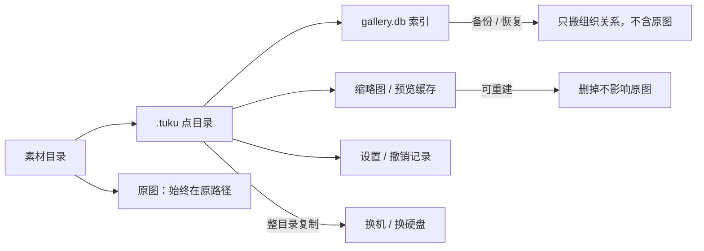
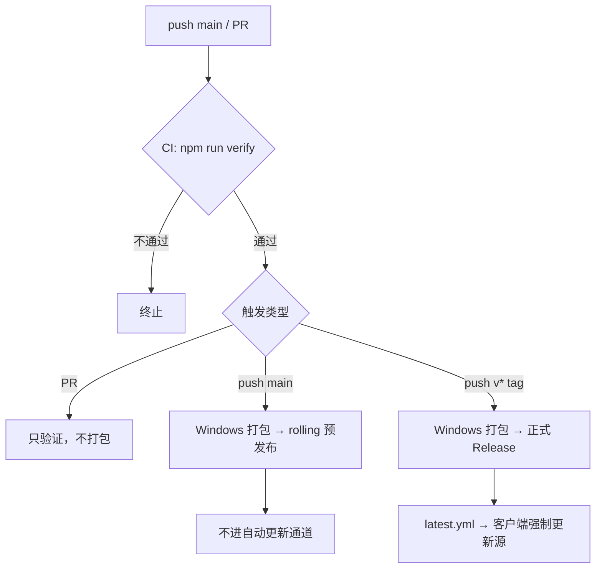

# 图库 TuKu

[](https://github.com/mr-awei/gallery/releases/latest)
[](#1-它是什么)
[](#4-架构与数据流)
[](#11-从源码运行)
[](#12-验证与质量)
[](LICENSE)

**本地优先的图片 / 素材管理工具。** 原图留在你自己的硬盘上，索引、标签、评分、笔记全部存在本地；不注册账号、不上传云端、断网照样能用。

> 仓库同时镜像在 [GitHub](https://github.com/mr-awei/gallery) 与 [Gitee](https://gitee.com/mr-awei/gallery)。自动更新只读 GitHub Releases，Gitee 仅作代码镜像。
>
> 完整的项目状态、竞品对标、完成项与路线图见 **[`docs/项目总览.html`](docs/项目总览.html)**（唯一权威文档）。GitHub / Gitee 上请点 **Raw** 或下载到本地，用浏览器打开即为可交互报告。

---

## 核心指标

| 指标 | 数值 | 说明 |
| --- | --- | --- |
| 设计规模 | 百万级 | worker 池 + 批量事务 + 单次解码 + 增量扫描 |
| 应用内教程 | 150 条 / 18 分类 | `F1` 打开，关键词搜索与命中高亮，随版本更新 |
| 验证覆盖 | smoke 89/89 · bench 15/15 | `npm run verify` 与 CI 同款 |
| 竞品对标 | 通用 8.17（第 1）/ 单机 8.88 | 10 维加权，Eagle 4 为 8.00 |
| 随包插件 | 4 个官方插件 | 能力白名单，独立子进程 |
| 水印 / 相框 | 23 款 / 20 款 | id 稳定，位置三级选择 + 本机字体 |
| 安装包 | NSIS · 约 200 MB | `TuKu-Setup-<version>.exe` |

---

## 目录

| | | |
| --- | --- | --- |
| [1 它是什么](#1-它是什么) | [2 下载与安装](#2-下载与安装) | [3 五分钟上手](#3-五分钟上手) |
| [4 架构与数据流](#4-架构与数据流) | [5 功能矩阵](#5-功能矩阵) | [6 竞品对标速览](#6-竞品对标速览) |
| [7 性能基准](#7-性能基准) | [8 快捷键](#8-快捷键) | [9 数据备份与迁移](#9-数据备份与迁移) |
| [10 MCP 与开放 API](#10-mcp-与开放-api) | [11 从源码运行](#11-从源码运行) | [12 验证与质量](#12-验证与质量) |
| [13 打包与发布](#13-打包与发布) | [14 常见问题](#14-常见问题) | [15 边界与说明](#15-边界与说明) |
| [16 更新记录](#16-更新记录) | [许可](#许可) | |

---

## 1 它是什么

| | 图库 TuKu | 云盘 / 在线相册 | 纯文件夹 |
| --- | --- | --- | --- |
| 原图位置 | 自己硬盘，不搬不改名 | 服务商 | 自己硬盘 |
| 组织方式 | 多层文件夹 + 标签 + 堆叠 + 智能文件夹 | 目录 / 相册 | 目录 |
| 检索 | 文件名 / 标签 / OCR / 颜色 / 语义 / 相似图 | 文件名 / 少量 AI | 文件名 |
| 离线可用 | 是 | 否 | 是 |
| 桌面集成 | 壁纸 / 托盘 / 快捷键 / 屏保 | 无 | 无 |
| 百万级 | 是 | 依赖服务端 | 不可用 |

Windows 桌面端（Electron）＋ 本地服务（Node）＋ Web UI，同一套数据三种打开方式。面向**单机创作者**：不做账号体系、不做实时行级云合并，把系统级集成与编辑产出做深。

---

## 2 下载与安装

从 [Releases](https://github.com/mr-awei/gallery/releases/latest) 下载 `TuKu-Setup-<version>.exe`（Windows 10/11，NSIS 安装包）。

- 安装版会接管常见图片 / 视频 / 音频的「打开方式」，双击图片即可用图库打开；便携版不改注册表
- 首次启动选择一个素材文件夹建库，**原文件不动**
- 更新在后台静默检查与下载，下载完成后才提示安装；安装失败可以选择「本次先继续用」


---

## 3 五分钟上手

| 步骤 | 动作 | 结果 |
| --- | --- | --- |
| 1 建库 | 首次启动选素材目录（如 `D:\图片`） | 库数据写到该目录 `.tuku`，原图不搬不改名 |
| 2 找图 | 顶部搜索框吃文件名 / 标签 / 描述 / OCR；筛选栏叠加类型、星级、颜色、画幅 | 支持 `tag:` `color:` `rating:>=4` `folder:` `kind:video` `is:favorite` 前缀 |
| 3 整理 | 勾选多张 → 底部批量条；拖图到左侧文件夹归档；拖标签到图片打标；按 `F` 快速分类 | 组织关系落库，不移动原文件 |
| 4 编辑 | 单击进大图，`←` `→` 翻页，`1`~`5` 打星；「更多」里有裁切、调色、标注、水印相框、擦除修复 | 破坏性编辑会写回原图，操作前请备份 |
| 5 查教程 | `F1`，输入「堆叠」「时间点笔记」「导出」 | 命中处高亮，内容随应用更新、不依赖网络 |

---

## 4 架构与数据流

```mermaid
flowchart TB
    subgraph UI[表现层]
        W[React + TypeScript + Vite<br/>仪表盘 / 图库 / 灯箱 / 设置 / 教程]
        X[浏览器扩展<br/>右键采集 / 拖拽 / 整页截图]
    end
    subgraph DESKTOP[Electron 主进程]
        M[窗口 / 托盘 / 壁纸 / 屏保<br/>全局快捷键 / IPC 校验 / 自动更新]
    end
    subgraph SVC[utilityProcess 服务 · 单属主]
        E[Express 5 · 仅绑 127.0.0.1<br/>Bearer 令牌 + scope 鉴权]
        S[SQLite · node:sqlite<br/>images / folders / image_folders / tags / notes / stacks]
        T[sharp 缩略图 + 磁盘缓存<br/>RAW / PSD / AI / 字体预览]
        C[CLIP / ONNX Runtime<br/>16 分桶 + int16 量化 + 上界剪枝]
        L[局域网只读实例<br/>独立端口 · 投送与分享链接]
    end
    subgraph DATA[本地数据]
        D[(素材目录 / .tuku / gallery.db)]
    end
    W -->|HTTP + Bearer| E
    X -->|采集 API| E
    M -->|启动 / 停止| E
    E --> S
    E --> T
    E --> C
    E --> L
    S --> D
    T --> D
```



**四条设计原则**

| 原则 | 落地方式 |
| --- | --- |
| 进程隔离 | 服务跑在 `utilityProcess` 子进程，崩溃不拖死界面；退出前先停服再关窗 |
| 百万级 | 分页查询 + 覆盖索引 + 缩略图懒加载；导入用 worker 池、批量事务、单次解码、增量扫描 |
| 可观测 | 失败一律有提示或日志，不吞异常；界面顶部错误条可重试，不把失败伪装成「空库」 |
| 安全 | 本地 API 令牌每次启动生成；IPC 校验窗口与 origin；`?token=` 仅限 GET；插件是能力白名单而非 OS 沙箱 |

---

## 5 功能矩阵

| 分类 | 关键能力 | 教程里搜 |
| --- | --- | --- |
| 浏览与搜索 | 瀑布流 / 网格 / 列表、空格快速预览、搜索前缀语法、多维筛选、排序 | `搜索语法` `快速预览` `筛选` |
| 文件夹与标签 | 多层文件夹、拖拽排序、图标与颜色、封面与锁定、标签分组 / 合并、拖标签打标、批量创建、保存筛选器 | `文件夹` `标签` `保存筛选` |
| 堆叠与笔记 | 图片堆叠（建组 / 拖拽并入 / 合并 / 设封面 / 解散）、多条文本笔记、视频音频时间点笔记 | `堆叠` `笔记` `时间点` |
| 整理与查重 | 待整理三视图、MD5 完全重复、pHash 相似重复、库-盘一致性、孤儿缩略图清理 | `查重` `失配` `待整理` |
| 编辑与导出 | 裁切、旋转、调色、擦除修复、标注、水印相框、插值增强、视频裁剪 / GIF / WebM、CSV / JSON / HTML 画廊 | `裁切` `水印` `导出` |
| 采集与导入 | 本地导入、拖拽投放、剪贴板、网页采集、浏览器扩展、屏幕截图、手机扫码投送 | `导入` `采集` `扩展` |
| 壁纸与桌面 | 一键设壁纸、自动换、动态壁纸（视频 / 网页 / GLSL / 粒子 / 音频可视化）、屏保、托盘、全局快捷键 | `壁纸` `动态壁纸` `托盘` |
| AI 与自动化 | CLIP 语义搜索、自动标签与描述、适配度评分、知识库问答、OCR、外部以图搜图、插件脚本、MCP / API | `语义搜索` `OCR` `MCP` |
| 数据与设置 | 多资源库、存储结构、备份恢复、快捷键自定义、命令面板、日志与更新 | `资源库` `备份` `快捷键` |
| 使用统计 | 每张素材的复制 / 导出次数与最近使用时间，仪表盘「使用统计」榜 | `使用统计` |

> 表格只是索引。**每个功能的完整说明、边界与快捷键都在应用内教程里**（`F1`），并且会随版本更新。

<details>
<summary><strong>展开：逐模块详细说明</strong></summary>

### 图库与浏览

- 三级视图：瀑布流（保留比例）、网格（等高裁切）、列表（一行一张，带尺寸 / 体积 / 时间 / 标签）。
- 搜索框支持白名单前缀：`tag:` `color:` `rating:>=4` `folder:` `kind:video` `is:favorite`，会与筛选栏叠加。
- 空格快速预览：鼠标悬停哪张就预览哪张，再按一次关闭；不改变选择状态。
- 多选：勾选、`Ctrl` 加减选、`Shift` 连选、拖拽框选；`Ctrl+A` 全选的是**当前筛选结果**，不只是已加载页。
- 收藏、五星评分、颜色标记都参与筛选；评分同时用于自动换壁纸的最低门槛。
- 删除先进回收站，可还原或彻底清除，清空前二次确认。

### 文件夹与标签

- 任意层级文件夹树；拖图归档、拖文件夹移动整枝；同一父级内拖动即排序，顺序持久保存。
- 文件夹可以设 **emoji 图标 + 主题色**，侧栏树与图库顶部的文件夹卡片都会显示；封面可手动指定，锁定后防误删。
- 图库顶部的**文件夹卡片区**：封面、emoji、色点、张数一屏可见，点卡片进入，拖图到卡片直接归档，可折叠。
- 标签支持分组、改色、重命名、合并；**把侧栏标签拖到卡片或列表行**即可追加打标。
- 批量创建：标签与子文件夹都能一行一个批量建，同名自动跳过，空标签也会立刻出现在列表里。
- **保存筛选器**：把搜索词 + 筛选条件 + 当前文件夹存成入口；悬停条目可以改名、**用当前条件覆盖更新**、删除。
- **智能文件夹**：把「最近 7 天 + 红色 + 4K」这类组合条件存为常驻集合，可预览并对命中图片批量打标。

### 堆叠与笔记

- 多选建堆叠，评分最高的当组主（封面）；一张图只属于一个堆叠。
- **拖图到组主卡片上直接并入**；桌面端默认拖拽是「拖出成文件」，按住 `Alt` 拖才是应用内叠堆。
- 卡片显示 `⧉ 张数`；查看器里可设封面（不按评分，点谁是谁）、移出、**并入其他堆叠**、解散。
- 拖走组主时，原组会自动提升剩下最早的一张当组主，不会散架。
- 笔记：每张多条，独立于单条「我的备注」；视频 / 音频可以把笔记**钉在当前播放时间**，点时间码直接跳回。
- 统计口径统一：堆叠成员不单独计数，张数、体积、标签云、待整理、文件夹张数都按「一组算一条」。

### 整理与查重

- 待整理三视图：未分类 / 无标签 / 未评分，处理完计数实时减少。
- 完全重复按 MD5；相似重复按感知哈希（pHash）分桶 + 汉明距离，裁切压缩调色过的同一张图也能聚类。
- 库-盘一致性检查：应用外改名 / 移动 / 删除导致路径失效时，列出失配项并尝试重新关联。
- 孤儿缩略图清理：先 `dryRun` 出清单再执行，空库或目录异常时直接拒绝。

### 编辑与导出

- 裁切：自由比例 + 常用比例，默认按**通用显著度**定位焦点（不是只找人脸）。
- 旋转 / 翻转、参数化调色、全自动调色（不压暗、不压平反差、饱和度只增）。
- 擦除修复：内容感知扩散，适合划痕 / 水印 / 电线 / 小物件；大图在 1200 长边工作副本上修复再映射。
- 标注：矩形、箭头、文字、序号、马赛克，坐标按原图比例保存。
- 水印 / 相框：23 款水印 + 20 款相框，位置三级选择 + 本机字体。
- 画质增强是**插值放大**，界面与文档都如实标注，不包装成 AI 超分。
- 视频：首尾裁剪可保存区间；导出 GIF（纯 JS GIF89a）或 WebM（MediaRecorder），不依赖 ffmpeg。
- 导出：单张下载、按文件夹结构导出、CSV / JSON、单文件 HTML 画廊；导出会累加使用统计。

### 采集与导入

- 本地导入递归扫描，跳过隐藏与垃圾目录，已入库文件增量跳过；导入用 worker 池 + 批量事务。
- 拖拽投放（窗口中央圆盘）、剪贴板粘贴图片或图片地址；手动采集不套 30KB / 800px 这类爬虫门槛。
- 网页采集：列表页批量抓图，可配质量门槛、页数与代理，记录来源 URL。
- 浏览器扩展：右键采集（图片 / 本页全部 / 整页截图）、拖拽悬浮球；整页截图逐屏拼接，最多 24 屏 / 16000px 高，超出会截断并提示。
- 手机扫码投送：同一 Wi-Fi 下扫码上传，独立端口与令牌，默认关闭。
- **只读分享链接**：生成 30 分钟 ~ 1 天的临时链接，手机 / 另一台设备可浏览、搜索当前库，不能上传；令牌只存服务端内存，重启或「全部撤销」立即失效。

### 壁纸与桌面

- 一键设 Windows 壁纸；自动换支持间隔、范围、顺序、最低评分与「不喜欢」排除。
- 动态壁纸：相册轮播、本地视频、网页、GLSL 着色器、交互粒子、音频可视化；参数滑块实时生效。
- 屏保按系统空闲时间全屏播放，键鼠一动立即退出，全屏游戏不打扰。
- 托盘常驻：换一张、收藏、不喜欢、暂停、打开主窗口；托盘菜单顶部保留「上次操作」文字。Windows 系统 toast 不可靠，操作反馈走自绘提示窗。
- 全局快捷键不开主窗口也能换壁纸。

### AI 与自动化

- 语义搜索：CLIP 图文向量检索，模型未下载时明确显示不可用，不假装搜过。
- 自动标签与描述、适配度评分（可解释指标，不是玄学打分）、知识库问答（回答带引用图片）。
- OCR：调用 Windows 内置引擎，识别结果可被搜索命中。
- 以图搜图：SauceNAO（需自填 Cookie）、Google Lens（需公网地址）、TinEye；失败会说明卡在哪一步。
- 插件：`plugins/<id>/plugin.json` + ESM 入口，独立子进程、只拿素材快照，写库需声明 `image:write` 且只允许 tags / note / rating / favorite。**能力白名单，不是 OS 沙箱**。随包 4 个官方插件（前缀打标 / 画幅与分辨率 / 媒体类型 / 备注补日期），设置页按「官方 / 用户」分组；主题包可导出 / 导入 `.tuku-pack`。
- MCP 与 `/api/v1`：见第 10 节。

### 数据与设置

- 多资源库：独立目录 + 独立 `gallery.db`，可分别放在不同硬盘；同一时刻只有一个激活。
- 跨库共享：微博 Cookie、网络代理、AI 接入配置；AI 总开关是库级的。
- 备份导出库索引与设置（不含原图）；恢复前建议先备份当前库。
- 快捷键可自定义，`Ctrl+K` 命令面板搜命令直接跳页面。
- 日志与崩溃转储可在设置里一键打开，启动时自动清理 7 天前的转储。

</details>

---

## 6 竞品对标速览

10 维加权评分，口径 2026-11-09。完整矩阵、权重可调的评分器与差距解剖见 [`docs/项目总览.html`](docs/项目总览.html)。

| 排名 | 产品 | 通用分 | 条形 | 单机分 | 定位 |
| --- | --- | --- | --- | --- | --- |
| 1 | **图库 TuKu** | **8.17** | `████████░░` | **8.88** | 本项目 |
| 2 | Eagle 4 | 8.00 | `████████░░` | 8.17 | 商业素材库 |
| 3 | Immich | 7.13 | `███████░░░` | 6.61 | 开源自托管 |
| 4 | PhotoPrism | 7.01 | `███████░░░` | 6.70 | 开源自托管 |
| 5 | Pixcall | 6.83 | `███████░░░` | 6.37 | 云同步素材库 |
| 6 | Billfish | 5.75 | `██████░░░░` | 5.80 | 免费素材库 |

| 维度 | 权重 | TuKu | Eagle | 差值 | 结论 |
| --- | --- | --- | --- | --- | --- |
| 检索与组织 | 15 | 9.5 | 9.5 | 0 | 已追平（智能文件夹 / 颜色 / 相似） |
| 预览与格式覆盖 | 7 | 9.5 | 9.5 | 0 | 已追平（RAW / PSD / AI / 字体） |
| 大库性能 | 12 | 9.0 | 7.5 | +1.5 | 领先 |
| 编辑与产出 | 12 | 8.0 | 7.5 | +0.5 | 领先 |
| 采集与导入 | 7 | 9.0 | 9.5 | −0.5 | 小幅落后 |
| AI 能力 | 10 | 8.0 | 8.0 | 0 | 打平 |
| 桌面集成 | 6 | 10 | 5.0 | +5.0 | 最大优势 |
| 扩展与集成 | 8 | 9.0 | 9.0 | 0 | 打平 |
| 跨平台与云协作 | 11 | 3.0 | 6.0 | −3.0 | 唯一实质短板 |
| 工程与文档 | 12 | 8.0 | 8.0 | 0 | 打平 |

> 通用口径领先 0.17；把跨端权重归零的个人单机口径领先 0.71。**跨平台与云协作仍是唯一需要重点投入的一维。**

---

## 7 性能基准

`npm run bench` 在临时库灌数据后打真实 HTTP 接口取 p50 / p95；另跑两条不经过 HTTP 的路径：调色预览（`renderPixels`）与 CLIP 向量检索。缺模型权重 / 无浏览器时明确跳过，不会假绿。

| 场景 | p95 | 门槛 | 结果 |
| --- | --- | --- | --- |
| 列表首页 `pageSize=100` | 6 ms | 200 ms | PASS |
| 列表深页 `page=199` | 10 ms | 400 ms | PASS |
| 关键词搜索 | 14 ms | 500 ms | PASS |
| 标签筛选（10% 命中） | 12 ms | 500 ms | PASS |
| 收藏筛选 | 3 ms | 300 ms | PASS |
| 标签列表（缓存） | 4 ms | 300 ms | PASS |
| 统计（缓存） | 3 ms | 150 ms | PASS |
| 调色预览 720 长边（拖动帧） | 21 ms | 25 ms | PASS |
| 调色预览 1600 长边（停手帧） | 70 ms | 80 ms | PASS |
| CLIP 2 万向量全库扫描 | 47 ms | 300 ms | PASS |
| CLIP 文本塔编码 | 5 ms | 500 ms | PASS |

百万行实测 10/10 达标：列表首页 30ms、深页 253ms、关键词搜索 406ms、标签筛选 309ms、收藏筛选 35ms、标签列表缓存 4ms、统计缓存 4ms。历史瓶颈已收口：`/api/tags` 797→4ms（倒排表聚合 + 指纹缓存）、`/api/stats` 冷查询 2562→1810ms 并改为快照。

---

## 8 快捷键

主窗口的全局键位都可以在设置 → 快捷键里改；大图 / 标注 / 工作台内部是场景专用键位。

| 键 | 作用 | 键 | 作用 |
| --- | --- | --- | --- |
| `Ctrl+K` | 命令面板（搜命令 / 页面 / 图片） | `Ctrl+F` | 聚焦搜索框 |
| `Alt+F` | 筛选器搜索 | `Space` | 快速预览鼠标下的素材 |
| `Ctrl+A` | 全选当前筛选结果 | `Delete` | 删除选中（进回收站） |
| `Ctrl+Z` | 撤销最近一次写入 | `F1` | 打开使用教程 |
| `?` | 快捷键速查面板 | `F` | 快速分类（卡片上是收藏） |
| `1` ~ `5` / `0` | 大图里打星 / 清除 | `←` `→` | 大图翻页 |
| `Esc` | 关闭大图 / 弹窗 / 清除选择 | | |

---

## 9 数据备份与迁移



- 库索引、缩略图、笔记、撤销记录都在素材目录的 `.tuku` 下；**原图始终在原路径**。
- 换机 / 换硬盘：把整个素材目录（含 `.tuku`）复制过去，再在应用里重新指定即可。
- 只想搬组织关系：用「备份 / 恢复」导出库索引与设置（不含原图）。
- 数据库升级在事务里执行、失败整体回滚，并会先留一份 `gallery.db.bak-v<版本>-<日期>` 快照；旧版本打开新结构库会告警并要求先备份。
- 缩略图按需生成，删掉可重建，不影响原图。
- **文件出口必须允许点目录**：`.tuku` 以点开头，静态服务需 `dotfiles: allow`，否则缩略图全部 404。

```
素材目录/
├── .tuku/                 库数据（随素材目录一起搬走）
│   ├── gallery.db         SQLite 索引（多库各自独立）
│   ├── thumbs/            缩略图与预览缓存（可重建）
│   └── settings/          库级设置
├── 设计稿/                原图，不搬不改名
└── 照片/
```

---

## 10 MCP 与开放 API

`npm run mcp` 启动 stdio MCP 服务（零依赖，JSON-RPC 2.0），把图库能力暴露给 Claude Desktop、Cursor、CodeBuddy 等客户端。

| 工具 | 作用 |
| --- | --- |
| `search_images` | 按关键词 / 条件搜图 |
| `set_wallpaper` / `set_wallpaper_by_query` | 指定图片或一句话换壁纸 |
| `next_wallpaper` / `current_wallpaper` | 换下一张 / 查当前 |
| `favorite_current` / `dislike_current` | 收藏 / 不喜欢当前壁纸 |
| `list_favorites` | 列出收藏 |
| `list_smart_folders` / `apply_smart_folder` | 列出并应用保存的筛选器 |

本地 HTTP 接口：

- `/api/v1` 是稳定契约，`Authorization: Bearer` + `read` / `write` / `ingest` 三级 scope
- 自带 OpenAPI 3.0 文档（`/api/v1/openapi.json`）、每分钟 120 次限流、审计日志不含令牌明文
- 附加令牌写在用户数据目录 `api-tokens.json`，或用 `TUKU_API_SCOPE_TOKENS` 注入
- 本地 API 的启动令牌每次启动重新生成；`?token=` 仅允许 GET，写操作必须走 header
- IPC 校验 `sender` 与同源；浏览器扩展采集端点只放行白名单扩展 ID

---

## 11 从源码运行

需要 Node.js ≥ 22.5（`node:sqlite` 为实验特性，启动时的 `ExperimentalWarning` 属正常）。

```bash
npm ci
npm run dev        # 后端(3001) + Vite(5173) + Electron 一起起
npm run dev:web    # 只起后端与网页（浏览器打开 5173 调试）
npm start          # 只跑本地服务（默认 3001），用已构建的 dist/web
```

### 目录结构

```
electron/          Electron 主进程、预加载桥、壁纸、托盘、自动更新
server/            本地服务：Express 路由、SQLite、缩略图、导入、采集、AI、MCP
  routes/          按领域拆分（organize / stats / collections / export / lan …）
  lib/             可复用逻辑（query / tags / stacks / clip-index / lan …）
web/src/           React 前端
  pages/           仪表盘、图库、采集、清单、教程、设置…
  components/      卡片、灯箱、对话框、文件夹卡片…
  lib/             快捷键、路由、教程内容（tutorial-content.ts + tutorial/extra-*.ts）
plugins/           4 个随包官方插件（plugin.json + ESM 入口）
extension/         浏览器扩展（随安装包以 extraResources 分发）
assets/samples/    示例素材（随安装包分发到 samples/）
test/              单测（node:test）
scripts/           冒烟、基准、发布、维护脚本
docs/              项目总览.html（唯一权威文档）
```

### 常用脚本

| 脚本 | 说明 |
| --- | --- |
| `npm run build` | 构建前端到 `dist/web` |
| `npm run typecheck` | 三段 tsconfig 全量类型检查 |
| `npm run lint` | ESLint + 自定义语法检查 |
| `npm run unit` | Node 原生 test runner，单测 |
| `npm run smoke` | 接口冒烟（会起临时服务） |
| `npm run bench` | 性能基准：临时库灌 20 万行，打真实接口取 p50 / p95；另含调色预览与 CLIP |
| `npm run bench:quick` | 2 万行快速版（约 7 秒，已接入 `verify`） |
| `npm run verify` | lint + typecheck + unit + smoke + bench:quick + 手动脚本登记检查（CI 同款） |
| `npm run dist` | 构建并打 Windows 安装包（`release-build/`） |
| `npm run mcp` | 启动 MCP stdio 服务 |
| `npm run import` | 命令行导入本地目录 |

---

## 12 验证与质量

| 环节 | 命令 | 本次结果 |
| --- | --- | --- |
| 静态检查 | `npm run lint` | 168 个文件，0 语法错误 / 0 告警 |
| 类型 | `npm run typecheck` | Web / Node / 纯函数库三套 tsconfig 通过 |
| 单测 | `npm run unit` | 全通过（鉴权、颜色搜索、CLIP 索引、RAW/PSD 解析、平台等） |
| 冒烟 | `npm run smoke` | 89/89 |
| 基准 | `npm run bench:quick` | 15/15 达标 |
| 人工清单 | `npm run verify:manual` | 10 个脚本登记齐全，实跑 1 个无头脚本 |

`npm run verify` 是发版前的唯一准绳，CI 跑同一套脚本。

> **CI 门槛口径**：GitHub Actions 是共享 runner，单核时延波动大，绝对 p95 门槛在 CI 中放宽 3 倍（输出里会标 `CI×3`），用来拦数量级回退；本地与专用压测机仍按原门槛严格判定。CI 失败时，`verify-out.txt` 会推到 `ci-logs-verify` 分支，`build-out.txt` 推到 `ci-logs` 分支，本地 `git fetch origin <分支> && git show origin/<分支>:<文件>` 即可取日志（匿名 API 读不到 Actions 日志）。
>
> 已知口径：`tsconfig.node.json` 的 `include` 已覆盖 `server/**`，但 `checkJs` 仍为 `false`，服务端只做语法与引用结构检查，安全关键纯函数另有语义闸。后续路线图已列入「真开 checkJs」。

---

## 13 打包与发布

```bash
npm run dist -- --publish never      # → release-build/TuKu-Setup-<version>.exe
```

- NSIS 安装包，`build.nsis.artifactName` 固定 `TuKu-Setup-${version}.exe`；`extraResources` 带上浏览器扩展与示例素材
- `asarUnpack` 展开 sharp / onnxruntime / jpegtran 等原生模块及其运行时 JS 依赖
- 安装版注册常见媒体格式打开方式；便携版不改注册表
- 输出目录被占用时换一个：`--config.directories.output=build-out`



| 触发 | 结果 |
| --- | --- |
| PR | 只跑 lint + typecheck + unit + smoke |
| push `main` | 安装包挂到固定 tag `rolling` 的**预发布**，不进自动更新通道 |
| push `v*` 标签 | 构建安装包 → 正式 Release → 成为客户端**强制更新源** |

### 发版步骤

```bash
# 1. 升版本（不自动打 tag）
npm version patch --no-git-tag-version
# 2. 全量验证
npm run verify
# 3. 提交
git add -A && git commit -m "feat: vX.Y.Z ..."
# 4. 打 tag 并点名推送（不要用 --tags）
git tag vX.Y.Z
git push origin main vX.Y.Z      # GitHub → 触发 CI 出正式 Release
git push gitee main vX.Y.Z       # Gitee → 仅代码镜像
# 5. 本地出包
npm run dist -- --publish never
```

> **不要用 `git push --tags`**：本地若残留陈旧的 `rolling` tag，远端同名 tag 由 CI 每次重建，整条命令会报 `already exists` 并失败。点名推具体 tag 最稳。
>
> **本地打包环境**：先删净整个 `release-build/` 输出目录（避免 builder 内部 rm 被安全软件或删除守卫拦截）；国内网络设 `ELECTRON_MIRROR=https://npmmirror.com/mirrors/electron/`；360「主动防御」服务（`ZhuDongFangYu`）可能锁住 `default_app.asar`，出现 `EBUSY` / `EPERM` 时再关闭它。签名由 `build.win.signtoolOptions` + `CSC_LINK` 驱动，CI 打包必须显式 `--publish never`。

### 产物核验清单

1. `app.asar` 顶层含 `express` / `call-bind-apply-helpers` / `server` / `electron` / `plugins` / `dist`，无 react 三件套
2. `app.asar.unpacked` 含 onnxruntime-node / onnxruntime-common / sharp 的原生二进制
3. `ELECTRON_RUN_AS_NODE=1 TuKu.exe -e "require(...)"` 实测原生模块可加载
4. 隔离 `userData` 启动，日志出现 `[desktop] 加载 http://127.0.0.1:<port>` 与托盘就绪

---

## 14 常见问题

<details>
<summary><strong>Q：断网还能用吗？</strong></summary>

能。检查更新失败不锁界面，只是暂时不升级。所有素材、索引、教程都在本地。
</details>

<details>
<summary><strong>Q：卸载或删库会删我的图片吗？</strong></summary>

不会。卸载、更新、删除资源库都只动程序与库索引；原图在素材目录里。回收站的彻底清除是否删原文件，取决于设置里的删除行为。
</details>

<details>
<summary><strong>Q：有的图显示不出来？</strong></summary>

大概率是文件在应用外被改名 / 移动 / 删除，或库目录换了盘符。先跑「库-盘一致性检查」重新关联，别急着重新导入（重导会丢评分与标签）。
</details>

<details>
<summary><strong>Q：为什么堆叠后总张数变少了？</strong></summary>

堆叠按一条统计：3 张同组素材在图库里显示 1 条。展开堆叠能看到全部成员；解散后张数恢复。
</details>

<details>
<summary><strong>Q：拖拽为什么没反应（桌面端）？</strong></summary>

桌面端默认拖拽是「拖出成文件」（可以拖进微信 / PS）。应用内叠堆请按住 `Alt` 拖；手动排序模式下拖拽是调整顺序。
</details>

<details>
<summary><strong>Q：教程在哪里？</strong></summary>

顶栏书本图标或 `F1`；设置 → 新手教程里也有入口。150 条说明分 18 个分类，支持关键词搜索与命中高亮，内容随应用更新，不依赖网络。
</details>

<details>
<summary><strong>Q：日志在哪？</strong></summary>

`%APPDATA%\TuKu\logs\`，也可以在设置 → 数据与维护里直接打开日志与崩溃转储目录。
</details>

<details>
<summary><strong>Q：更新卡住 / 装不上？</strong></summary>

下载在后台进行，不遮挡使用；只有确认下载完成才提示安装。安装失败可以选择「本次先继续用」，下次启动会重新拉起服务。
</details>

<details>
<summary><strong>Q：数据能搬到另一台机器吗？</strong></summary>

把素材目录连同 `.tuku` 一起拷走最省事；只想搬组织关系就用「导出 → 恢复」（不含原图）。
</details>

<details>
<summary><strong>Q：托盘图标不见了？</strong></summary>

Windows 会把新图标收进「隐藏的图标」，拖出来固定即可，应用仍在运行。
</details>

---

## 15 边界与说明

| 主题 | 如实说明 |
| --- | --- |
| AI 是可选能力 | 本地模型需下载，云端需自填密钥；模型缺失时功能明确置灰或报错，不给假结果 |
| 增强不是超分 | 画质增强是插值放大；擦除修复是内容感知扩散，不是生成式 AI |
| 云同步口径 | 只有「同步文件夹 + 版本快照」，没有在线账号与实时行级合并；两端显式发布 / 拉取，冲突明确报出 |
| 备份不含原图 | 导出的是库索引与设置 |
| 插件不是沙箱 | 能力白名单只能限制写库字段，不能隔离文件系统；只装自己信任的插件 |
| 跨平台 | Windows 为完整能力；macOS / Linux 配置了打包目标，保证「能启动并使用图库」，Win32 专有能力会明确降级并说明原因 |
| 强制更新 | 正式 Release 即更新源，没有「稍后再说」；离线环境可用 `TUKU_FORCE_UPDATE=off` 自行构建 |
| 破坏性编辑 | 裁切、旋转、增强、调色会写回原图文件与数据库字段，操作前请自行备份 |

---

## 16 更新记录

### v1.2.2（2026-11-09）

**文档与工程状态对齐**：`docs/` 收敛为单一 [`项目总览.html`](docs/项目总览.html)（竞品对标 / 能力清单 / 完成项 / 路线图 / 39 条遗留待办），删除三份带日期的历史 HTML 与临时日志、旧安装包。

按代码逐项复核并上调五维评分：

- **检索追平 Eagle（8.5→9.5）**：智能文件夹规则落库 + 五个 REST 端点、OKLab 颜色搜索、pHash 分桶 + CLIP 相似优先
- **预览格式补齐（8.5→9.5）**：RAW 按 SOF 精度抽 8 位内嵌 JPEG、PSD/PSB 自研合成解码、AI/EPS 内嵌位图、Sketch/XD/Figma zip 预览、字体字形渲染
- **大库性能（8→9）**：CLIP 16 分桶 + int16 量化 + 桶级上界剪枝 + 64KB 磁盘分块扫描（如实标注：不是 IVF/PQ 聚类）
- **采集与扩展（各 →9.0）**：右键三项、拖拽悬浮球、4 个随包官方插件、主题包导入导出；市场页与导入时命名模板仍缺，不虚报满分
- **局域网**：只读分享链接、投送设置与二维码、macOS AppleScript 路径转义

`npm run verify` 全绿（smoke 89/89、bench 15/15），本地包 199.8 MB 并实测 asar 内容、原生模块与隔离启动。

### v1.2.1（2026-11-08）

**使用教程从小抄变成手册**：条目从 55 条扩到 **150 条 / 18 个分类**，逐个控件、菜单、角标、设置项各一条；搜索支持关键词直达与命中高亮，`F1` 随时打开。

- 教程数据按主题拆分（`tutorial-content.ts` 保留核心流程，`tutorial/extra-*.ts` 续写逐控件条目），同分类 id 自动合并
- 顶栏书本图标与 `F1` 同一入口；左侧导航显示每个分类的条数，首项「全部」带总数
- 文档同步：README 按实现逐条核对重写，修正整页截图上限（实为 24 屏 / 16000px 高）

按竞品对标结论做的一轮工程收口：

- **性能有据可依**：新增 `scripts/bench.mjs`，在临时库里灌行再打真实接口取 p95。百万行实测 10/10 达标：列表首页 30ms、深页 253ms、关键词搜索 406ms、标签筛选（10% 命中）309ms、收藏筛选 35ms、标签列表缓存 4ms、统计缓存 4ms
- 复测同时修掉三处真瓶颈：`/api/stats` 冷查询 2562→1810ms 并改为快照；`/api/tags` 从「拉全库 tags 串进 Node 切分」改为倒排表聚合 + 写入指纹缓存（797→4ms）；统计的 4 条全表聚合合并为 2 条
- 基准补上两条不经过 HTTP 的路径：调色预览（720 长边拖动帧 p95 23ms、1600 长边停手帧 70ms、4000×3000 原图 570ms）与 CLIP 全库扫描上界
- **只读分享**：局域网独立实例新增浏览与只读分享令牌，手机页分「浏览 / 投送」两栏；只读令牌上传一律 403
- **官方插件 1 → 4**：画幅与分辨率打标、媒体类型打标、备注补日期，设置页按官方 / 用户分组
- **类型闸扩容**：`checkJs` 覆盖从 5 个模块扩到 17 个；任务历史从 5s 轮询改为 `job` SSE
- **修复 macOS 脚本注入**：壁纸 / 废纸篓的 AppleScript 统一转义路径中的引号与反斜杠（真机仍未回归）

### v1.2.0（2026-11-08）

新增「使用教程」：应用内按功能分类的操作手册，支持关键词搜索与命中高亮，`F1` 随时打开。

同时补齐一批高频整理能力：文件夹 emoji 图标 + 主题色、手动拖拽排序、图库顶部文件夹卡片；保存筛选器（支持用当前条件覆盖更新）；图片堆叠（建组 / 并入 / 设封面 / 解散 / 拖走组主自动换主）；每张多条笔记与视频音频时间点笔记；批量创建标签与子文件夹；拖标签打标；使用统计；快速分类。计数口径统一：堆叠成员按一条算。

修复：切库后保存的筛选器串库；改标签 / 评分后堆叠角标丢失；删除素材残留笔记；列表视图无法拖标签；弹窗 `Esc` 关不掉。

### v1.1.4（2026-11-08）

- 修复 CR2 / NEF / ARW 等相机 RAW 的缩略图与预览提取（按 8 位精度筛出真正的相机预览段）
- 修复 RAW / 视频 / 音频等非图片素材不进文件夹的问题，启动时回填历史漏挂记录
- 修复 RAW 卡片一次失败就永久「暂无预览」：缩略图 404 改 `no-store` 并支持插队生成，卡片退避重试
- 开机自启不再弹出「正在启动本地服务」加载窗
- 动态壁纸单张图片加载失败自动重试 / 跳过，移动硬盘晚挂载可自愈
- 撤销 / 刷新 / 清理缺失等工具移入页面右键菜单，新增「打开所在位置」

---

## 许可

本项目为**专有软件，保留所有权利**（All Rights Reserved）。源码公开在 GitHub / Gitee，仅供查看、学习与安全审计；**未授予任何开源许可**，未经书面授权不得复制、修改、分发、商用或再发布。完整条款见根目录 [LICENSE](LICENSE)。
