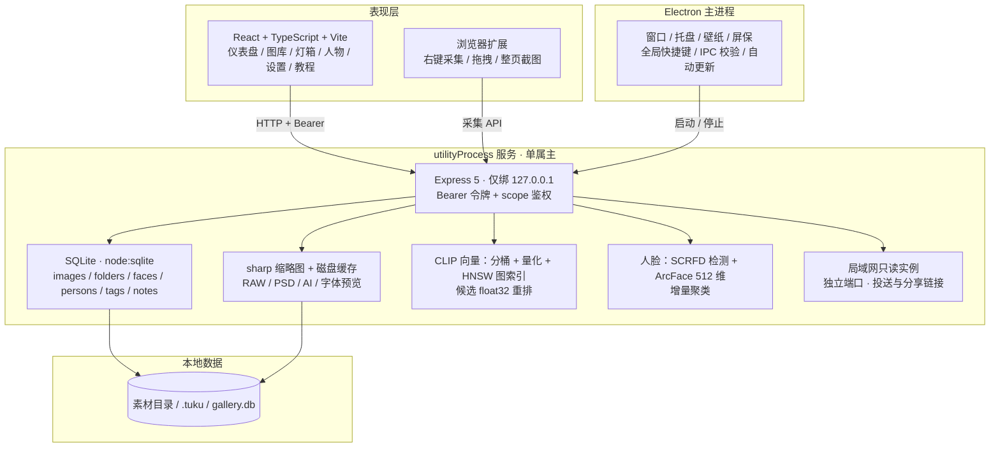
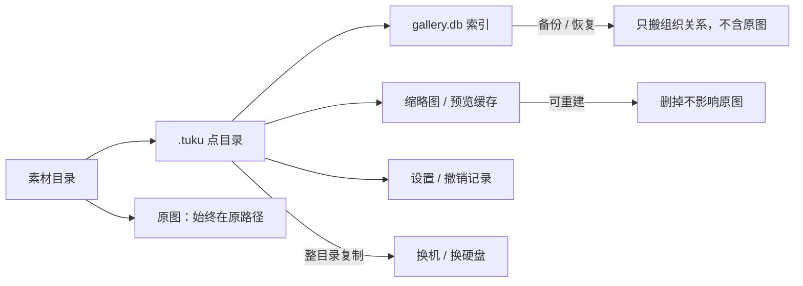
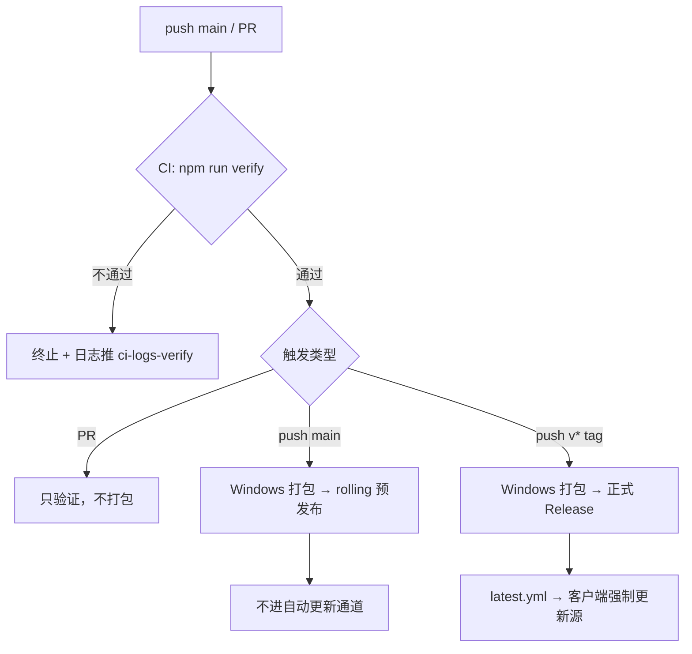

# 图库 TuKu

[](https://github.com/mr-awei/gallery/releases/latest)
[](#1-它是什么)
[](#4-架构与数据流)
[](#11-从源码运行)
[](#12-验证与质量)
[](LICENSE)

**本地优先的图片 / 素材管理工具。** 原图留在你自己的硬盘上，索引、标签、评分、笔记、人脸特征全部存在本地；不注册账号、不上传云端、断网照样能用。

> 仓库同时镜像在 [GitHub](https://github.com/mr-awei/gallery) 与 [Gitee](https://gitee.com/mr-awei/gallery)。自动更新只读 GitHub Releases，Gitee 仅作代码镜像。
>
> **现状 / 未完成欠账 / 对标与机会点见 [`docs/项目现状与差距.html`](docs/项目现状与差距.html)**。GitHub / Gitee 上请点 **Raw** 或下载到本地用浏览器打开。

---

## 核心指标

| 指标 | 数值 | 说明 |
| --- | --- | --- |
| 设计规模 | 百万级 | worker 池 + 批量事务 + 单次解码 + 增量扫描 |
| 验证覆盖 | 单测 363 · 冒烟 118/118 · 基准 15/15 · 四闸类型 | `npm run verify` 一条命令跑完，CI 同款 |
| 已知缺口 | 3 项：地点视图、英文界面长尾、macOS 真机验收 | 逐条列在文档 02 节，含现状 / 成本 / 对应机会点 |
| 竞品对标 | 通用 8.23（第 1）/ 单机 8.93 | 10 维加权，Eagle 4 为 8.00 / 8.17 |
| 类型检查 | electron + server + routes + server-lib 全覆盖 | 逐文件 `@ts-check`，由 lint 强制守门 |
| 随包插件 | 4 个官方插件 + 库级启停 + 在线市场 | 能力白名单，独立子进程 |
| 水印 / 相框 | 23 款 / 20 款 | id 稳定，位置三级选择 + 本机字体 |
| 应用内教程 | 150 条 / 18 分类 | `F1` 打开，关键词搜索与命中高亮，随版本更新 |
| 人脸模型 | 191 MB（SCRFD 16.9 + ArcFace 174） | 本地推理，权重按可信 sha256 校验 |
| 安装包 | NSIS · 约 200 MB | `TuKu-Setup-<version>.exe` |

> 「验证全绿」与「没有缺陷」是两件事。前者可以复跑，后者要按代码逐条读 —— 所以这份 README 只写「现在能干什么」，没做到的 3 项连同成本摆在 `docs/项目现状与差距.html` 02 节，不在这里自评清白。

---

## 目录

| | | |
| --- | --- | --- |
| [1 它是什么](#1-它是什么) | [2 下载与安装](#2-下载与安装) | [3 五分钟上手](#3-五分钟上手) |
| [4 架构与数据流](#4-架构与数据流) | [5 功能矩阵](#5-功能矩阵) | [6 竞品对标速览](#6-竞品对标速览) |
| [7 性能基准](#7-性能基准) | [8 快捷键](#8-快捷键) | [9 数据备份与迁移](#9-数据备份与迁移) |
| [10 MCP 与开放 API](#10-mcp-与开放-api) | [11 从源码运行](#11-从源码运行) | [12 验证与质量](#12-验证与质量) |
| [13 打包与发布](#13-打包与发布) | [14 常见问题](#14-常见问题) | [15 边界与说明](#15-边界与说明) |
| [16 更新记录](#16-更新记录) | [许可](#许可) | |

---

## 1 它是什么

| | 图库 TuKu | 云盘 / 在线相册 | 纯文件夹 |
| --- | --- | --- | --- |
| 原图位置 | 自己硬盘，不搬不改名 | 服务商 | 自己硬盘 |
| 组织方式 | 多层文件夹 + 标签 + 堆叠 + 智能文件夹 + 人物 | 目录 / 相册 | 目录 |
| 检索 | 文件名 / 标签 / OCR / 颜色 / 语义 / 相似图 / 按人 | 文件名 / 少量 AI | 文件名 |
| 离线可用 | 是 | 否 | 是 |
| 桌面集成 | 壁纸 / 托盘 / 快捷键 / 屏保 | 无 | 无 |
| 百万级 | 是 | 依赖服务端 | 不可用 |

Windows 桌面端（Electron）＋ 本地服务（Node）＋ Web UI，同一套数据三种打开方式。面向**单机创作者**：不做账号体系、不做实时行级云合并，把系统级集成与编辑产出做深。

**不做什么**：账号体系、在线图床、实时协同编辑、跨端行级合并、云同步（只做「同步文件夹 + 版本快照」）。跨平台只保证「能启动并使用图库」，Win32 专属能力（壁纸挂载）明确降级并说明原因。

---

## 2 下载与安装

从 [Releases](https://github.com/mr-awei/gallery/releases/latest) 下载 `TuKu-Setup-<version>.exe`（Windows 10/11，NSIS 安装包）。

- 安装版会接管常见图片 / 视频 / 音频的「打开方式」，双击图片即可用图库打开；便携版不改注册表
- 首次启动选择一个素材文件夹建库，**原文件不动**
- 更新在后台静默检查与下载，下载完成后才提示安装；安装失败可以选择「本次先继续用」
- AI 能力按需下载模型（语义搜索、去背景、超分运行库、人脸），不下也能用其余全部功能


---

## 3 五分钟上手

| 步骤 | 动作 | 结果 |
| --- | --- | --- |
| 1 建库 | 首次启动选素材目录（如 `D:\图片`） | 库数据写到该目录 `.tuku`，原图不搬不改名 |
| 2 找图 | 顶部搜索框吃文件名 / 标签 / 描述 / OCR；筛选栏叠加类型、星级、颜色、画幅 | 支持 `tag:` `color:` `rating:>=4` `folder:` `kind:video` `is:favorite` 前缀；语义搜索走「关键词 + 向量」混合排序 |
| 3 整理 | 勾选多张 → 底部批量条；拖图到左侧文件夹归档；拖标签到图片打标；按 `F` 快速分类 | 组织关系落库，不移动原文件 |
| 4 认人 | 侧栏「人物」→ 下载人脸模型 → 扫描全库 | 自动按人分组，可改名、合并、删除；同一人的照片一处看全 |
| 5 编辑 | 单击进大图，`←` `→` 翻页，`1`~`5` 打星；「更多」里有裁切、调色、标注、水印相框、擦除修复 | 破坏性编辑会写回原图，操作前请备份 |
| 6 查教程 | `F1`，输入「堆叠」「时间点笔记」「导出」 | 命中处高亮，内容随应用更新、不依赖网络 |

---

## 4 架构与数据流



**四条设计原则**

| 原则 | 落地方式 |
| --- | --- |
| 进程隔离 | 服务跑在 `utilityProcess` 子进程，崩溃不拖死界面；退出前先停服再关窗；主进程不直接引用 `server/db.js` |
| 百万级 | 分页查询 + 覆盖索引 + 缩略图懒加载；导入用 worker 池、批量事务、单次解码、增量扫描；向量检索在 3000~12 万区间走 HNSW，越界退回分桶扫描 |
| 可观测 | 失败必须有提示或日志，禁止 `catch` 之后静默放行：删除失败、模型哈希写入失败、切库后代理失败都要说出来。新增写入路径必须同时给出失败反馈，回归在 `verify` 里 |
| 安全 | 本地 API 令牌每次启动生成；IPC 校验窗口与 origin；`?token=` 仅限 GET；插件是能力白名单而非 OS 沙箱 |

**前端结构**：`App.tsx` 只做编排与 JSX（1869 行），状态按领域下沉到 `web/src/hooks/`：

| hook | 职责 |
| --- | --- |
| `useGalleryList` | 分页、请求代数（丢弃过期响应）、定位后补载、刷新加序 |
| `useStatsAndTags` | 库增长对账、标签树节流刷新、角标计数 |
| `useFolderTree` | 文件夹增删改、进入 / 返回、面包屑 |
| `useSelection` | 多选、框选、全选当前筛选结果 |
| `useLightbox` | 大图导航池、左右翻页、预取 |
| `useSavedFilters` / `useSidebarWidth` / `useAppKeyBindings` | 保存筛选器、侧栏宽度、全局快捷键 |

> 列表的 `refreshGallery` 需要统计的 `refreshStats`，而 `refreshStats` 又依赖列表的 `load` —— 这层循环依赖用 `ref` + `useCallback` 稳定的取值器打通，保证回调身份不随渲染变化（否则 `memo` 与 60s 兜底定时器都会失效）。低频页面全部 `React.lazy` 分包，首包 1312 kB；灯箱与编辑器仍在首屏路径上，继续瘦身的机会点见文档 #15。

---

## 5 功能矩阵

| 分类 | 关键能力 | 教程里搜 |
| --- | --- | --- |
| 浏览与搜索 | 瀑布流 / 网格 / 按文件夹收纳、**时间线（年 → 月 → 日）**、空格快速预览、搜索前缀语法、多维筛选、排序、混合检索（关键词 + 语义） | `搜索语法` `时间线` `快速预览` `筛选` |
| 文件夹与标签 | 多层文件夹、拖拽排序、图标与颜色、封面与锁定、标签分组 / 合并、拖标签打标、批量创建、**批量改信息（评分 / 收藏 / 标签 / 备注）**、保存筛选器、智能文件夹（AND/OR 嵌套） | `文件夹` `标签` `批量改信息` `智能文件夹` |
| 人物 | 本地人脸扫描、按人聚类、改名 / 合并 / 删除、同人阈值三档、质量门槛（糊脸不进聚类）、手动设封面并锁定、按人看图、灯箱内改派 / 移除单张脸 | `人物` `人脸` |
| 堆叠与笔记 | 图片堆叠（建组 / 拖拽并入 / 合并 / 设封面 / 解散）、多条文本笔记、视频音频时间点笔记 | `堆叠` `笔记` `时间点` |
| 整理与查重 | 待整理三视图、MD5 完全重复、pHash 相似重复、库-盘一致性、孤儿缩略图清理、缩略图失败队列（批量重试） | `查重` `失配` `待整理` |
| 编辑与导出 | 裁切、旋转、调色、擦除修复、标注、水印相框、插值增强、**非破坏编辑（裁切 / 旋转 / 调色只记操作链，原图不动）**、视频裁剪 / GIF / WebM、图片拼接、CSV / JSON / HTML 画廊 | `裁切` `水印` `非破坏` `导出` |
| 采集与导入 | 本地导入（内容级去重 / 命名模板 / 断点续传 / 同步盘冲突识别）、拖拽投放、剪贴板、网页采集、浏览器扩展、手机扫码投送、**只读分享（有效期 / 密码 / 禁下载）** | `导入` `采集` `扩展` `分享` |
| 壁纸与桌面 | 一键设壁纸、自动换、动态壁纸（视频 / 网页 / GLSL / 粒子 / 音频可视化）、屏保、托盘、全局快捷键 | `壁纸` `动态壁纸` `托盘` |
| AI 与自动化 | CLIP 语义搜索、自动标签与描述、适配度评分、知识库问答、OCR、外部以图搜图、AI 多供应商、API Playground、插件脚本、MCP / API | `语义搜索` `OCR` `MCP` |
| 数据与设置 | 多资源库、同步文件夹快照、备份恢复、快捷键自定义、命令面板、日志与诊断、检查更新 | `资源库` `备份` `快捷键` `关于软件` |
| 使用统计 | 每张素材的复制 / 导出次数与最近使用时间，仪表盘「使用统计」榜 | `使用统计` |

> 表格只是索引。**每个功能的完整说明、边界与快捷键都在应用内教程里**（`F1`），并且会随版本更新。

<details>
<summary><strong>展开：逐模块详细说明</strong></summary>

### 图库与浏览

- **三种展示方式自由切换**（顶部视图切换组，记住上次选择）：瀑布流（保留比例）、网格（等高裁切）两种「图片展开」视图，外加「按文件夹收纳」视图。列表视图已移除。
- **图片展开就是全量平铺**：两种图片视图顶部不再插一排文件夹卡片，直接把当前范围内的素材全部铺出来；进入某个文件夹时同样包含其全部子文件夹的素材。
- **按文件夹收纳**（Eagle 式）：同一层级的文件夹各自成组，显示封面 / 名称 / 张数 / 子夹数；点文件夹进入（含全部后代），点箭头就地展开组内图片；组内图片滚到附近才懒加载，拖图到卡片即归档；支持面包屑、按名称找文件夹、全部展开 / 收起、未归档素材一键展开。
- **文件名与路径就是入口**：灯箱顶栏的文件名、详情面板里的库路径与归属文件夹、素材工具箱里的原文件路径都能点 —— 在资源管理器里定位这张图，或直接跳到「只看这一夹」；不用再去右键菜单里翻。
- **页头常驻吸顶**：各页页头（标题、筛选、扫描、批量按钮）滚动时停在顶部；页内的二级吸顶（设置页左栏、整理页任务条、教程页分类）自动让到页头下沿，页头因换行变高也不会错位。
- 搜索框支持白名单前缀：`tag:` `color:` `rating:>=4` `folder:` `kind:video` `is:favorite`，会与筛选栏叠加。
- **混合检索**：语义搜索把关键词命中与向量近邻用 RRF 融合，结果标注每条来自哪一路；engine 字段明确返回 `hybrid` / `keyword` / `loading`，模型没就绪时如实说明而不是假装搜过。
- **时间线视图**：按拍摄时间分「年份 → 月份 → 当天」，每月带代表图封条与张数，点某天直接回到那一批。**归档口径只有照片自己的时间**：EXIF 拍摄时间（含 EXIF 里的修改时间）优先，其次取文件「修改时间 / 创建时间」中较早的那个，**绝不使用收录进来的时间** —— 拿入库时间当拍摄时间会让 2019 年拍的照片全堆到导入那天。两者都取不到的图先不排入并计数，页内一键「重建拍摄时间」（后台任务、可取消、有进度）会重新读一遍 EXIF 与文件时间。
- 空格快速预览：鼠标悬停哪张就预览哪张，再按一次关闭；不改变选择状态。
- 多选：勾选、`Ctrl` 加减选、`Shift` 连选、拖拽框选；`Ctrl+A` 全选的是**当前筛选结果**，不只是已加载页。
- 收藏、五星评分、颜色标记都参与筛选；评分同时用于自动换壁纸的最低门槛。
- 删除先进回收站，可还原或彻底清除，清空前二次确认。

### 文件夹与标签

- 任意层级文件夹树；拖图归档、拖文件夹移动整枝；同一父级内拖动即排序，顺序持久保存。
- **仪表盘与图库常驻侧栏顶部**，收藏 / 人物 / 清单 / 采集 / 书签以小图标常驻其下，都不参与折叠收纳；只有「待整理 / 保存的筛选 / 标签」分组可折叠，折叠状态与文件夹树展开状态都会记住。
- 灯箱底部缩略图条对 **RAW / 设计稿** 也显示内嵌预览画面，缩略图尚未生成时自动补一次，仍失败才回退文件图标。
- 侧栏右边界平时就可见，中间的小握把提示可左右拖动调宽，双击复位。
- 文件夹可以设 **emoji 图标 + 主题色**，侧栏树与「按文件夹收纳」视图都会显示；封面可手动指定，锁定后防误删。
- 标签支持分组、改色、重命名、合并、别名；**把侧栏标签拖到图片卡片或列表行**即可追加打标。
- **批量改信息**：多选后一次改评分 / 收藏 / 标签（添加 · 移除 · 替换）/ 备注，走单个事务（上限 5000 张），整批只记一条撤销记录 —— 一次 `Ctrl+Z` 全回滚。改标题仍归「批量重命名」，不在这里混着做。
- 批量创建：标签与子文件夹都能一行一个批量建，同名自动跳过，空标签也会立刻出现在列表里。
- **保存筛选器**：把搜索词 + 筛选条件 + 当前文件夹存成入口；悬停条目可以改名、**用当前条件覆盖更新**、删除。
- **智能文件夹**：把「最近 7 天 + 红色 + 4K」这类组合条件存为常驻集合，可预览并对命中图片批量打标。规则支持**分组与 AND / OR 嵌套**，旧规则自动视为单个 AND 组，行为不变；空分组会被忽略（否则 OR 会捞全库）。

### 人物

- **全本地推理**：SCRFD det_10g 负责检测（含 5 点关键点），ArcFace w600k_r50 出 512 维特征；两张 ONNX 合计 191 MB，照片不出本机。
- 扫描是**增量**的：扫过的素材打标记，下次只处理新增；进度落任务中心，可随时停止、可重跑。
- 自动聚成「人物」：同人阈值默认 0.42，可在扫描前选「严格 0.50 / 标准 0.42 / 宽松 0.35」；同一张脸换个尺寸、旋转、重新压缩仍能认出来（特征余弦实测 0.94~1.00）。
- **门槛分三层**：能显示（`keep`）< 能进人物（`cluster`）< 能当封面（`coverRank = 质量 × min(1, facePx/96)^0.5`）。糊脸、侧脸、小图不会被推成人物封面；整簇平均质量过低会被解散，不留下「一个模糊的人」。
- 人物可改名、合并、删除；删除只清人脸记录，图片与标签不受影响。封面可在照片墙悬停时**手动指定并锁定**，之后扫描 / 清理 / 重建都不会按分数换掉它。
- **灯箱里能看到「这张图有谁」**：显示人名，可把某张脸改派到另一个人物，也可直接移除；无人脸时整块不渲染。这一格用的是自绘下拉（带搜索框、弹层最小 200px），库里有上千个人物时按名字直接定位。
- 模型走随包可信哈希清单：安装前后都比对 sha256，不符即删包报错，不会静默加载被替换的权重。

### 堆叠与笔记

- 多选建堆叠，评分最高的当组主（封面）；一张图只属于一个堆叠。
- **拖图到组主卡片上直接并入**；桌面端默认拖拽是「拖出成文件」，按住 `Alt` 拖才是应用内叠堆。
- 卡片显示 `⧉ 张数`；查看器里可设封面（不按评分，点谁是谁）、移出、**并入其他堆叠**、解散。
- 拖走组主时，原组会自动提升剩下最早的一张当组主，不会散架。
- 笔记：每张多条，独立于单条「我的备注」；视频 / 音频可以把笔记**钉在当前播放时间**，点时间码直接跳回。
- 统计口径统一：堆叠成员不单独计数，张数、体积、标签云、待整理、文件夹张数都按「一组算一条」。

### 整理与查重

- 待整理三视图：未分类 / 无标签 / 未评分，处理完计数实时减少。
- 完全重复按 MD5；相似重复按感知哈希（pHash）分桶 + 汉明距离，裁切压缩调色过的同一张图也能聚类。
- 库-盘一致性检查：应用外改名 / 移动 / 删除导致路径失效时，列出失配项并尝试重新关联。
- 孤儿缩略图清理：先 `dryRun` 出清单再执行，空库或目录异常时直接拒绝。
- **缩略图失败队列**：待生成 / 生成中 / 累计失败 / 库里缺图四个数字，失败项带原因（文件缺失、解码失败、格式不支持）；支持**单张重试**（200 条里只有一张被临时占用时不必整批重跑）、**一键重试全部**与**清空失败明细**。
  > 重试只重新排队生成缩略图，不动原图；文件确实不在盘上时，重试会继续失败并把原因写成「文件缺失」。

### 编辑与导出

- 裁切：自由比例 + 常用比例，默认按**通用显著度**定位焦点（不是只找人脸）。
- 旋转 / 翻转、参数化调色、全自动调色（不压暗、不压平反差、饱和度只增）。
- **非破坏编辑（设置里可选开）**：打开后裁切 / 旋转 / 调色只往 `edit_ops` 记操作链，原文件一个字节都不动；缩略图 / 预览 / 原图 / 下载 / 导出 / 插件接口 / 局域网分享都按操作链渲染，成品单独缓存，缓存键带操作链版本号。灯箱「更多 → 非破坏编辑」可看清单、**应用到底片**或**整体还原**，每加一步都是独立撤销记录。增强 / 超分 / 擦除这类「结果就是新像素」的动作仍写回原图。
- 擦除修复：内容感知扩散，适合划痕 / 水印 / 电线 / 小物件；大图在 1200 长边工作副本上修复再映射。
- 标注：矩形、箭头、文字、序号、马赛克，坐标按原图比例保存。
- 水印 / 相框：23 款水印 + 20 款相框，位置三级选择 + 本机字体。
- 画质增强是**插值放大**，界面与文档都如实标注，不包装成 AI 超分。
- 视频：首尾裁剪可保存区间；导出 GIF（纯 JS GIF89a）或 WebM（MediaRecorder），不依赖 ffmpeg。
- 导出：单张下载、按文件夹结构导出、CSV / JSON、单文件 HTML 画廊、图片拼接 / 联系表；导出会累加使用统计。
- **反向导出 Eagle 库**：把当前库写成 Eagle 4 的 `.library`（原图 + 文件夹层级 + 标签 + 星级）。数据出口里先显示「张数 · 体积 · 文件夹数」再决定要不要导，导出走后台任务 —— 可看进度、可停止、结束进任务历史，取消或失败会删掉本次写出的半成品目录。

### 采集与导入

- 本地导入递归扫描，跳过隐藏与垃圾目录（含同步盘临时文件），已入库文件增量跳过；导入用 worker 池 + 批量事务。
- **导入时内容级去重**：先用文件大小快筛，只对同字节数的候选算 MD5，命中即跳过，并回报「跳过 N 张重复」。
- **断点续传**：导入进度落 `import-job.json`，中途退出后重启按「已中断」展示，继续即重跑增量扫描（未变文件自动跳过）。
- **同步盘友好**：识别 `*sync-conflict*`、`~$*` 等冲突副本，照常入库但单独计数，避免悄悄变成两份。
- 拖拽投放（窗口中央圆盘）、剪贴板粘贴图片或图片地址；手动采集不套 30KB / 800px 这类爬虫门槛。
- 网页采集：10 个源（Bing / 百度 / 搜狗 / 360 / 堆糖 / 微博 / Wallhaven / 豆瓣 / 贴吧 / Wikimedia），可配质量门槛、页数与代理，记录来源 URL；任务可断点续采。
- 浏览器扩展：右键采集（图片 / 本页全部 / 整页截图）、拖拽悬浮球；整页截图逐屏拼接，最多 24 屏 / 16000px 高，超出会截断并提示。
- 手机扫码投送：同一 Wi-Fi 下扫码上传，独立端口与令牌，默认关闭。端口优先固定 `53317`（被占用才由系统分配），二维码内容与页面显示的地址严格同源；多网卡可手动选择，设置页提供「本机连通性自检」与防火墙 / 同网排查指引。轮换令牌不会重启服务、不会换端口。手机页可选目标文件夹（按 id 挂载，纯虚拟夹也能落进去），路径方式 `?folder=a/b` 仍兼容。
- **只读分享链接**：生成 30 分钟 ~ 1 天的临时链接，手机 / 另一台设备可浏览、搜索当前库，不能上传；可选**访问密码**与**禁止下载原图**，列表直接标出这两项状态。令牌只存服务端内存，重启或「全部撤销」立即失效。

### 壁纸与桌面

- 一键设 Windows 壁纸；自动换支持间隔、范围、顺序、最低评分与「不喜欢」排除。
- 动态壁纸：相册轮播、本地视频、网页、GLSL 着色器、交互粒子、音频可视化；参数滑块实时生效。
- 屏保按系统空闲时间全屏播放，键鼠一动立即退出，全屏游戏不打扰。
- 托盘常驻：换一张、收藏、不喜欢、暂停、打开主窗口；托盘菜单顶部保留「上次操作」文字。Windows 系统 toast 不可靠，操作反馈走自绘提示窗。
- 全局快捷键不开主窗口也能换壁纸。

### AI 与自动化

- 语义搜索：CLIP 图文向量检索；向量数在 3000~12 万之间时走 HNSW 图索引，候选按 `max(k*3, k+8)` 多取后做 float32 精确余弦重排；模型未下载时明确显示不可用，不假装搜过。
- 自动标签与描述、适配度评分（可解释指标，不是玄学打分）、知识库问答（回答带引用图片）。
- OCR：调用 Windows 内置引擎，识别结果可被搜索命中。
- 以图搜图：SauceNAO（需自填 Cookie）、Google Lens（需公网地址）、TinEye；失败会说明卡在哪一步。
- **AI 多供应商**：OpenAI / 兼容接口 / 本地 Ollama 各存一份配置，可同时存在并一键切换；激活时回写顶层字段，旧调用点无感；密钥只回掩码。
- **API Playground**：在设置页里选接口、填参数、发送，直接看状态码、耗时与 JSON。
- **批量动作（Actions）**：把打标签、改标题、移文件夹、评分、OCR、AI 描述 / AI 指令串成一条动作，对选中素材一次执行（上限 500 张）。三个配套能力：**执行条件**（评分 / AI 匹配度 / 标签 / 关键词 / AI 关键词 / 收藏 / 画幅，AND·OR，与智能文件夹同一套规则）、**逐图预演**（确定性步骤给出「改前 → 改后」，AI / OCR / 插件步骤如实标注无法预演，全程不写库）、**一键撤销**（执行即写操作日志，按快照还原字段并摘掉本次新加的文件夹）。
  > 条件编辑器与智能文件夹共用 `ConditionEditor`，字段对齐到同一套白名单 —— 后端认得的条件，界面上一定填得出来，不再出现「接口支持、面板没口」。
- 插件：`plugins/<id>/plugin.json` + ESM 入口，独立子进程、只拿素材快照，写库需声明 `image:write` 且只允许 tags / note / rating / favorite。**能力白名单，不是 OS 沙箱**。随包 4 个官方插件（前缀打标 / 画幅与分辨率 / 媒体类型 / 备注补日期），可在设置页**库级启用 / 停用**（停用后执行被明确拒绝），并支持插件市场在线安装；主题包可导出 / 导入 `.tuku-pack`。
- MCP 与 `/api/v1`：见第 10 节。

### 数据与设置

- 多资源库：独立目录 + 独立 `gallery.db`，可分别放在不同硬盘；同一时刻只有一个激活。
- 跨库共享：微博 Cookie、网络代理、AI 接入配置；AI 总开关是库级的。
- 同步文件夹：库索引既可「备份 / 恢复」，也可在同步盘里显式发布 / 拉取快照，冲突明确报出而不是静默覆盖。
- 备份导出库索引与设置（不含原图）；恢复时会按新根目录重映射路径，缺失项单独列出。
- 快捷键可自定义，`Ctrl+K` 命令面板搜命令直接跳页面。
- **中英双语目前的实际范围**：侧栏、顶栏导航、筛选栏（11 个排序 / 8 个分组 / 浏览与星级）、灯箱与其「更多」菜单、非破坏编辑面板、时间线、图库空状态与采集引导、人物页主要文案、设置页 17 个分区标题与部分正文。仍是中文的：图片卡片、批量改信息对话框、水印工作室、调色室、设置页部分分区正文、应用内教程。切换即时生效，语言存 `localStorage`；**缺键回退中文，不会出现空标签**。
- **下载中心**（设置 → 运行状态 → 下载中心）：超分 / 抠图 / 人脸 / 语义四类共 16 项模型集中在一页，显示是否已装、实际占盘（stat 磁盘，不用清单里的预估）、可清理体积；每行支持下载、取消、校验、重新下载、删除。进度走 SSE，下载中实时更新，不用反复刷新。状态以磁盘为准，`sizeHint` 只用于「未装时显示约多少 MB」。
- 日志与崩溃转储可在「设置 → 关于软件 → 目录与诊断」一键打开，同页还能复制完整诊断信息；启动时自动清理 7 天前的转储。
- **关于软件**（设置最后一个分区）：版本号与安装形态、检查更新与下载进度、开机自启与「启动时自动检查更新」开关、Electron / Chromium / Node / V8 与系统架构、程序数据 / 日志 / 崩溃转储目录、帮助与反馈链接、开源组件清单。版本与环境一律由主进程 `app-info` 提供，前端不硬编码。

</details>

---

## 6 竞品对标速览

10 维加权评分，口径 2026-11-09（2026-11-10 复核未改分）。完整的「现状 / 差距 / 未完成 / 机会点」见 [`docs/项目现状与差距.html`](docs/项目现状与差距.html)。

| 排名 | 产品 | 通用分 | 条形 | 单机分 | 定位 |
| --- | --- | --- | --- | --- | --- |
| 1 | **图库 TuKu** | **8.23** | `████████░░` | **8.93** | 本项目 |
| 2 | Eagle 4 | 8.00 | `████████░░` | 8.17 | 商业素材库 |
| 3 | Immich | 7.13 | `███████░░░` | 6.61 | 开源自托管 |
| 4 | PhotoPrism | 7.01 | `███████░░░` | 6.70 | 开源自托管 |
| 5 | Pixcall | 6.83 | `███████░░░` | 6.37 | 云同步素材库 |
| 6 | Billfish | 5.75 | `██████░░░░` | 5.80 | 免费素材库 |

| 维度 | 权重 | TuKu | Eagle | 差值 | 结论 |
| --- | --- | --- | --- | --- | --- |
| 检索与组织 | 15 | 9.5 | 9.5 | 0 | 已追平（智能文件夹嵌套 / 颜色 / 相似 / 混合检索） |
| 预览与格式覆盖 | 7 | 9.5 | 9.5 | 0 | 已追平（RAW / PSD / AI / 字体） |
| 大库性能 | 12 | 9.0 | 7.5 | +1.5 | 领先（HNSW + 重排、百万行接口实测） |
| 编辑与产出 | 12 | 8.0 | 7.5 | +0.5 | 领先 |
| 采集与导入 | 7 | 9.0 | 9.5 | −0.5 | 小幅落后 |
| AI 能力 | 10 | 8.0 | 8.0 | 0 | 打平（人脸与多供应商已落地，暂不调分） |
| 桌面集成 | 6 | 10 | 5.0 | +5.0 | 最大优势 |
| 扩展与集成 | 8 | 9.0 | 9.0 | 0 | 打平（插件启停 / 市场 / Playground / MCP） |
| 跨平台与云协作 | 11 | 3.0 | 6.0 | −3.0 | 唯一实质短板 |
| 工程与文档 | 12 | 8.5 | 8.0 | +0.5 | 四闸类型 / 363 单测 / 118 冒烟；数字由 `verify` 自动回写，文档不手抄 |

> 通用口径领先 0.23；把跨端权重归零的个人单机口径领先 0.76。**跨平台与云协作仍是唯一需要重点投入的一维，而它卡在产品决策上，不是写代码能解决的。**

---

## 7 性能基准

`npm run bench` 在临时库灌数据后打真实 HTTP 接口取 p50 / p95；另跑两条不经过 HTTP 的路径：调色预览（`renderPixels`）与 CLIP 向量检索。缺模型权重 / 无浏览器时明确跳过，不会假绿。

以下为 2026-11-09 `npm run bench:quick`（2 万行）实测：

| 场景 | p95 | 门槛 | 结果 |
| --- | --- | --- | --- |
| 列表首页 `pageSize=100` | 7 ms | 200 ms | PASS |
| 列表深页 `page=199` | 10 ms | 400 ms | PASS |
| 关键词搜索 | 13 ms | 500 ms | PASS |
| 标签筛选（10% 命中） | 12 ms | 500 ms | PASS |
| 收藏筛选 | 5 ms | 300 ms | PASS |
| 标签列表（缓存） | 4 ms | 300 ms | PASS |
| 标签列表（重算） | 13 ms | 1200 ms | PASS |
| 统计（缓存） | 3 ms | 150 ms | PASS |
| 统计（冷查询） | 37 ms | 1500 ms | PASS |
| 调色预览 720 长边（拖动帧） | 22 ms | 25 ms | PASS |
| 调色预览 1600 长边（停手帧） | 70 ms | 80 ms | PASS |
| 调色预览 4000×3000（原图） | 571 ms | 仅记录 | — |
| CLIP 2 万向量全库扫描 | 45 ms | 300 ms | PASS |
| CLIP 文本塔编码 | 6 ms | 500 ms | PASS |

百万行历史实测（2026-11-08，10/10 达标）：列表首页 30 ms、深页 253 ms、关键词搜索 406 ms、标签筛选 309 ms、收藏筛选 35 ms、标签列表缓存 4 ms、统计缓存 4 ms。历史瓶颈已收口：`/api/tags` 797→4 ms（倒排表聚合 + 指纹缓存）、`/api/stats` 冷查询 2562→1810 ms 并改为快照。

> **CI 口径**：共享 runner 的单核时延抖动大，`scripts/bench.mjs` 在 `CI=true` 时把绝对门槛放宽 3 倍并打印 `CI×3`，只拦数量级回退；本地与专用压测机仍按原门槛严格判定。

---

## 8 快捷键

主窗口的全局键位都可以在设置 → 快捷键里改；大图 / 标注 / 工作台内部是场景专用键位。

| 键 | 作用 | 键 | 作用 |
| --- | --- | --- | --- |
| `Ctrl+K` | 命令面板（搜命令 / 页面 / 图片） | `Ctrl+F` | 聚焦搜索框 |
| `Alt+F` | 筛选器搜索 | `Space` | 快速预览鼠标下的素材 |
| `Ctrl+A` | 全选当前筛选结果 | `Delete` | 删除选中（进回收站） |
| `Ctrl+Z` | 撤销最近一次写入 | `F1` | 打开使用教程 |
| `?` | 快捷键速查面板 | `F` | 快速分类（卡片上是收藏） |
| `1` ~ `5` / `0` | 大图里打星 / 清除 | `←` `→` | 大图翻页 |
| `Esc` | 关闭大图 / 弹窗 / 清除选择 | | |

---

## 9 数据备份与迁移



- 库索引、缩略图、笔记、撤销记录都在素材目录的 `.tuku` 下；**原图始终在原路径**。
- 换机 / 换硬盘：把整个素材目录（含 `.tuku`）复制过去，再在应用里重新指定即可。
- 只想搬组织关系：用「备份 / 恢复」导出库索引与设置（不含原图）；恢复会按新根目录重映射，并把缺失文件单独列出来。
- 数据库升级在事务里执行、失败整体回滚，并会先留一份 `gallery.db.bak-v<版本>-<日期>` 快照。
  > **快照写不出来就不迁移**：结构迁移前若 `VACUUM INTO` 失败（磁盘满、权限、文件被占用），启动会直接中止并说明原因，库结构一个字段都不动 —— 不留「以为有回退点、其实没有」的局面。只有当库是被更高版本创建（降级安装）时，才退化成「告警 + 继续」，因为那种情况不动结构。
- 旧版本打开新结构库会告警并要求先备份。
- 缩略图按需生成，删掉可重建，不影响原图。
- **文件出口必须允许点目录**：`.tuku` 以点开头，静态服务需 `dotfiles: allow`，否则缩略图全部 404。

```
素材目录/
├── .tuku/                 库数据（随素材目录一起搬走）
│   ├── gallery.db         SQLite 索引（多库各自独立）
│   ├── thumbs/            缩略图与预览缓存（可重建）
│   └── settings/          库级设置
├── 设计稿/                原图，不搬不改名
└── 照片/
```

---

## 10 MCP 与开放 API

`npm run mcp` 启动 stdio MCP 服务（零依赖，JSON-RPC 2.0），把图库能力暴露给 Claude Desktop、Cursor、CodeBuddy 等客户端。

| 工具 | 作用 |
| --- | --- |
| `search_images` | 按关键词 / 条件搜图 |
| `set_wallpaper` / `set_wallpaper_by_query` | 指定图片或一句话换壁纸 |
| `next_wallpaper` / `current_wallpaper` | 换下一张 / 查当前 |
| `favorite_current` / `dislike_current` | 收藏 / 不喜欢当前壁纸 |
| `list_favorites` | 列出收藏 |
| `list_smart_folders` / `apply_smart_folder` | 列出并应用保存的筛选器 |

本地 HTTP 接口：

- `/api/v1` 是稳定契约，`Authorization: Bearer` + `read` / `write` / `ingest` 三级 scope
- 自带 OpenAPI 3.0 文档（`/api/v1/openapi.json`）、每分钟 120 次限流、审计日志不含令牌明文
- 附加令牌写在用户数据目录 `api-tokens.json`，或用 `TUKU_API_SCOPE_TOKENS` 注入
- 本地 API 的启动令牌每次启动重新生成；`?token=` 仅允许 GET，写操作必须走 header
- IPC 校验 `sender` 与同源；浏览器扩展采集端点只放行白名单扩展 ID
- 设置页的 **API Playground** 可以直接调这些接口，不必另装 curl 客户端

---

## 11 从源码运行

需要 Node.js ≥ 22.5（`node:sqlite` 为实验特性，启动时的 `ExperimentalWarning` 属正常）。

```bash
npm ci
npm run dev        # 后端(3001) + Vite(5173) + Electron 一起起
npm run dev:web    # 只起后端与网页（浏览器打开 5173 调试）
npm start          # 只跑本地服务（默认 3001），用已构建的 dist/web
```

### 目录结构

```
electron/          Electron 主进程、预加载桥、壁纸、托盘、自动更新（全部 // @ts-check）
server/            本地服务：Express 路由、SQLite、缩略图、导入、采集、AI、人脸、MCP
  routes/          按领域拆分（organize / stats / collections / export / lan / face …）
  lib/             可复用逻辑（query / tags / stacks / clip / hnsw / face-math / lan …）
  model-pins.json  模型与运行库的可信 sha256 清单（随包只读）
web/src/           React 前端
  hooks/           列表 / 统计 / 文件夹 / 选择 / 灯箱 / 键位等 8 个 hook
  pages/           仪表盘、图库、人物、采集、清单、教程、设置…
  components/      卡片、灯箱、对话框、文件夹卡片…
  lib/             快捷键、路由、i18n、视频取帧、教程内容（tutorial-content.ts + tutorial/extra-*.ts）
plugins/           4 个随包官方插件（plugin.json + ESM 入口）+ _market 索引
extension/         浏览器扩展（随安装包以 extraResources 分发）
assets/samples/    示例素材（随安装包分发到 samples/）
test/              单测（node:test，363 例）
scripts/           冒烟、基准、发布、维护脚本；lint.mjs 负责类型闸守门
docs/              项目现状与差距.html（唯一文档：现状 / 差距 / 未完成 / 机会点）
```

### 常用脚本

| 脚本 | 说明 |
| --- | --- |
| `npm run build` | 构建前端到 `dist/web` |
| `npm run typecheck` | 四段 tsconfig 全量类型检查（Web / Node / 纯函数库 / server-lib） |
| `npm run lint` | ESLint + 自定义语法检查 + 类型闸 pragma 校验 |
| `npm run unit` | Node 原生 test runner，363 例 |
| `npm run smoke` | 接口冒烟（会起临时服务），118 项 |
| `npm run bench` | 性能基准：临时库灌 20 万行，打真实接口取 p50 / p95；另含调色预览与 CLIP |
| `npm run bench:quick` | 2 万行快速版（约 7 秒，已接入 `verify`） |
| `npm run verify` | lint + typecheck + unit + smoke + bench:quick + 手动脚本登记检查（CI 同款） |
| `npm run dist` | 构建并打 Windows 安装包（`release-build/`） |
| `npm run mcp` | 启动 MCP stdio 服务 |
| `npm run import` | 命令行导入本地目录 |
| `npm run pin-models` | 把已验证的模型 / 运行库哈希写进 `model-pins.json` |

---

## 12 验证与质量

| 环节 | 命令 | 本次结果 |
| --- | --- | --- |
| 静态检查 | `npm run lint` | 185 个文件，0 错误 / 0 告警；`electron/**`、`server/lib/**`、`server/routes/**` 缺 `@ts-check` 直接失败 |
| 类型 | `npm run typecheck` | Web / Node / 纯函数库 / server-lib 四套 tsconfig 通过 |
| 单测 | `npm run unit` | 363/363（鉴权、颜色搜索、CLIP 索引、HNSW 召回、人脸几何、RAW/PSD、模型清单、插件市场、名称模板、LAN、回收站、相似检索、非破坏几何等） |
| 冒烟 | `npm run smoke` | 118/118 |
| 基准 | `npm run bench:quick` | 15/15 达标 |
| 人工清单 | `npm run verify:manual` | 10 个脚本登记齐全，实跑 1 个无头脚本 |

`npm run verify` 是发版前的唯一准绳，CI 跑同一套脚本。

> **全绿不等于无缺陷。** 这套命令只覆盖「已经写进测试的路径」，`server/routes/**` 的直接测试仍缺失（下次复审重点）。当前 3 项欠账（地点视图、英文界面、macOS 真机验收），逐条列在 `docs/项目现状与差距.html` 第 02 节；表里的统计数字由 `verify` 末尾自动回写，不再手抄。

**类型闸怎么工作**：`tsconfig.node.json` 的 `checkJs` 仍是 `false` —— 全局打开会把被 import 的 `server/*.js` 整片拖进来，噪音无法按目录收敛。所以采用**逐文件 `// @ts-check`**：

| 范围 | 状态 |
| --- | --- |
| `web/src`（TS） | `tsconfig.json` 原生类型检查 |
| `electron/**` | 8 个文件全部 `@ts-check`，由 `tsconfig.node.json` 检查 |
| `server/lib/**` | 全部 `@ts-check`，另有 `tsconfig.server.json` 深闸 |
| `server/*.js`、`server/routes/**` | 全部 `@ts-check` |
| 纯函数库 | `tsconfig.lib.json` |

> 漏写 pragma = lint 失败，所以「新文件忘了开检查」不会悄悄发生。这道闸值钱的地方在于：它抓的是那种**跑起来不报错、结果全错**的缺陷 —— 例如引用了不存在的 Electron API（电池判定恒为真）、联合类型没被收窄（一条本该 `skipped` 的分支当成成功走完）。这类问题测试很难覆盖，类型检查一读就出来。

> **CI 门槛口径**：GitHub Actions 是共享 runner，单核时延波动大，绝对 p95 门槛在 CI 中放宽 3 倍（输出里会标 `CI×3`）。CI 失败时，`verify-out.txt` 会推到 `ci-logs-verify` 分支，`build-out.txt` 推到 `ci-logs` 分支，本地 `git fetch origin <分支> && git show origin/<分支>:<文件>` 即可取日志（匿名 API 读不到 Actions 日志）。

---

## 13 打包与发布

```bash
npm run dist -- --publish never      # → release-build/TuKu-Setup-<version>.exe
```

- NSIS 安装包，`build.nsis.artifactName` 固定 `TuKu-Setup-${version}.exe`；`extraResources` 带上浏览器扩展与示例素材
- `asarUnpack` 展开 sharp / onnxruntime / jpegtran 等原生模块及其运行时 JS 依赖
- 安装版注册常见媒体格式打开方式；便携版不改注册表
- 输出目录被占用时换一个：`--config.directories.output=build-out`



| 触发 | 结果 |
| --- | --- |
| PR | 只跑 lint + typecheck + unit + smoke |
| push `main` | 安装包挂到固定 tag `rolling` 的**预发布**，不进自动更新通道 |
| push `v*` 标签 | 构建安装包 → 正式 Release → 成为客户端**强制更新源** |

### 发版步骤

```bash
# 1. 升版本（不自动打 tag）
npm version patch --no-git-tag-version
# 2. 全量验证
npm run verify
# 3. 提交
git add -A && git commit -m "feat: vX.Y.Z ..."
# 4. 打 tag 并点名推送（不要用 --tags）
git tag vX.Y.Z
git push origin main vX.Y.Z      # GitHub → 触发 CI 出正式 Release
git push gitee main vX.Y.Z       # Gitee → 仅代码镜像
# 5. 本地出包
npm run dist -- --publish never
```

> **不要用 `git push --tags`**：本地若残留陈旧的 `rolling` tag，远端同名 tag 由 CI 每次重建，整条命令会报 `already exists` 并失败。点名推具体 tag 最稳。
>
> **tag 构建失败会断掉强制更新源**：`releases/tags/vX.Y.Z` 会 404、`releases/latest` 停在上个版本。修完 CI 后把 tag 前移到修复提交并 `git push -f origin refs/tags/vX.Y.Z` 重新触发，`workflow_dispatch` 只出 rolling 预发布，不能替代。
>
> **本地打包环境**：先删净整个 `release-build/` 输出目录（避免 builder 内部 rm 被安全软件或删除守卫拦截）；国内网络设 `ELECTRON_MIRROR=https://npmmirror.com/mirrors/electron/`；360「主动防御」服务（`ZhuDongFangYu`）可能锁住 `default_app.asar`，出现 `EBUSY` / `EPERM` 时再关闭它。CI 打包必须显式 `--publish never`。

### 产物核验清单

1. `app.asar` 顶层含 `express` / `call-bind-apply-helpers` / `server` / `electron` / `plugins` / `dist`，无 react 三件套
2. `app.asar.unpacked` 含 onnxruntime-node / onnxruntime-common / sharp 的原生二进制
3. `ELECTRON_RUN_AS_NODE=1 TuKu.exe -e "require(...)"` 实测原生模块可加载
4. 隔离 `userData` 启动，日志出现 `[desktop] 加载 http://127.0.0.1:<port>` 与托盘就绪

---

## 14 常见问题

<details>
<summary><strong>Q：断网还能用吗？</strong></summary>

能。检查更新失败不锁界面，只是暂时不升级。所有素材、索引、教程、人脸特征都在本地。
</details>

<details>
<summary><strong>Q：卸载或删库会删我的图片吗？</strong></summary>

不会。卸载、更新、删除资源库都只动程序与库索引；原图在素材目录里。回收站的彻底清除是否删原文件，取决于设置里的删除行为。
</details>

<details>
<summary><strong>Q：有的图显示不出来？</strong></summary>

大概率是文件在应用外被改名 / 移动 / 删除，或库目录换了盘符。先跑「库-盘一致性检查」重新关联，别急着重新导入（重导会丢评分与标签）。
</details>

<details>
<summary><strong>Q：为什么堆叠后总张数变少了？</strong></summary>

堆叠按一条统计：3 张同组素材在图库里显示 1 条。展开堆叠能看到全部成员；解散后张数恢复。
</details>

<details>
<summary><strong>Q：拖拽为什么没反应（桌面端）？</strong></summary>

桌面端默认拖拽是「拖出成文件」（可以拖进微信 / PS）。应用内叠堆请按住 `Alt` 拖；手动排序模式下拖拽是调整顺序。
</details>

<details>
<summary><strong>Q：人脸模型多大？会不会上传我的照片？</strong></summary>

191 MB（检测 16.9 MB + 特征 174 MB），下载一次即可，之后完全离线。照片只在本机解码与推理，特征与框存在你的 `gallery.db` 里，不联网、不上传。删掉模型目录随时可以重下。
</details>

<details>
<summary><strong>Q：同一个人被分成了两组（或者两个陌生人被并在一起）？</strong></summary>

人物页可以合并两组，也可以删掉错误的人物。想整体重来就去「清空并重扫」并换一档同人阈值：严格 0.50 宁可分开、标准 0.42、宽松 0.35 对侧脸更友好。阈值改了必须重扫才对已有结果生效。
</details>

<details>
<summary><strong>Q：模型下载失败 / 提示校验不通过？</strong></summary>

下载按随包清单比对 sha256，不符会删包并报「可能被替换」。先确认网络能访问镜像（hf-mirror / GitHub Releases），重试一次；仍失败时日志里会写明是体积异常、签名不符还是哈希不匹配。
</details>

<details>
<summary><strong>Q：教程在哪里？</strong></summary>

顶栏书本图标或 `F1`；设置 → 教程里也有入口。150 条说明分 18 个分类，支持关键词搜索与命中高亮，内容随应用更新，不依赖网络。
</details>

<details>
<summary><strong>Q：日志在哪？</strong></summary>

`%APPDATA%\TuKu\logs\`，也可以在设置 → 关于软件 → 目录与诊断里直接打开日志与崩溃转储目录。
</details>

<details>
<summary><strong>Q：更新卡住 / 装不上？</strong></summary>

下载在后台进行，不遮挡使用；只有确认下载完成才提示安装。安装失败可以选择「本次先继续用」，下次启动会重新拉起服务。
</details>

<details>
<summary><strong>Q：数据能搬到另一台机器吗？</strong></summary>

把素材目录连同 `.tuku` 一起拷走最省事（人脸特征与人物名也在里面）；只想搬组织关系就用「导出 → 恢复」（不含原图）。
</details>

<details>
<summary><strong>Q：为什么界面大部分还是中文？</strong></summary>

中英双语覆盖了导航、侧栏、筛选栏、灯箱、时间线、人物页、设置页分区标题；图片卡片、批量改信息对话框、水印工作室、调色室、设置页部分正文与应用内教程仍是中文。缺英文时回退中文，不会出现空标签；要改哪一块，在设置 → 通用里切语言即可，不必重启。
</details>

---

## 15 边界与说明

| 主题 | 如实说明 |
| --- | --- |
| 已知未做项 | 3 项（G1 地点视图 / G2 英文界面长尾 / G3 macOS 真机验收，见 `docs/项目现状与差距.html` 02 节） |
| 验证覆盖不等于无缺陷 | `npm run verify` 全绿只证明已写进测试的路径没坏；`server/routes/**` 目前没有直接测试 |
| AI 是可选能力 | 本地模型需下载，云端需自填密钥；模型缺失时功能明确置灰或报错，不给假结果 |
| 人脸是本地聚类 | 不是身份识别，只回答「这些脸像不像同一个人」；不给人物贴真实姓名，名字由你自己起 |
| 增强不是超分 | 画质增强是插值放大；擦除修复是内容感知扩散，不是生成式 AI |
| 云同步口径 | 只有「同步文件夹 + 版本快照」，没有在线账号与实时行级合并；两端显式发布 / 拉取，冲突明确报出 |
| 地图未做 | EXIF 的 GPS 会解析成数值与可读文本，供水印与元信息用；没有地图视图，也没引入任何底图依赖 |
| 备份不含原图 | 导出的是库索引与设置 |
| 插件不是沙箱 | 能力白名单只能限制写库字段，不能隔离文件系统；只装自己信任的插件 |
| 跨平台 | Windows 为完整能力；macOS / Linux 配置了打包目标，保证「能启动并使用图库」，Win32 专有能力会明确降级并说明原因（macOS 尚未真机验收，主进程也没有 darwin 专属分支） |
| 强制更新 | 正式 Release 即更新源，没有「稍后再说」；离线环境可用 `TUKU_FORCE_UPDATE=off` 自行构建 |
| 编辑是否改原图 | 默认「存副本」：裁切 / 调色 / 水印 / 擦除 / 批量有保存步骤，原图不动。打开「非破坏性编辑」后，裁切 / 旋转 / 调色连副本都不生成，只记操作链、随时还原。仍会写回原图的是旋转（未开非破坏时）/ 增强 / 超分这类即时动作 —— 动手前请自行备份 |
| 微博采集 | 受站点登录限制，必须配 Cookie；未登录时任务会明确报错，不影响其他源 |
| 后端有、前端没接 | 只剩壁纸目录自检（`/api/wallpaper/live/fscheck`）—— 能力在，入口不在 |

---

## 16 更新记录

### v1.2.10（2026-11-12）

**三条实报 + 三处顺手修的坑：**

- **下载中心能「全部下载」**：头部按钮显示「全部下载（N 项 · 约 X）」，点了把没装的模型一次性排进队列。**串行**而不是并发——同一条带宽、Hub 会限流，多数模块也只有一个下载态，并发只会互相覆盖进度。单项失败（哈希不对、404）不中断整批，跑完汇总「装好几项 / 失败哪几项」；页面上随时能「取消全部下载」，服务端 `GET|POST /api/models/install-all` + `POST /api/models/install-all/cancel`，路由挂在 `:id` 之前，别被 `/:id/install` 吞掉。
- **文件明明在却搜不到**：搜索原来只看标题 / 标签 / 全文索引，**目录名根本不在检索范围**，多层文件夹里的图搜夹名自然是 0 张。现在多两条命中路径：物理路径 `abs_path LIKE`（含全部祖先层级）和虚拟文件夹名（`image_folders` 反查）。口径抽成纯函数 `buildSearchClause()`，配 5 例单测锁占位符与参数个数，再补两条冒烟（目录名、虚拟夹名各一）。短词仍走 LIKE、≥3 字仍走 trigram。
- **文件夹视图只在当前层过滤**：左边树里明明挂着这个夹，右边却说「没有」。现在搜索时**跨全库所有层级**找，结果卡标题下多一行层级路径（`20190822清华经管 / 20190823清华经管学院（李伟）`），空结果分「全库没有名称包含…」和「这一层还没有子文件夹」两种说法。
- **「全部有拍摄时间」却被判成没有**：月份查询原条件 `taken_at <> ''` 漏了空串以外的空态，v1.2.8 清空 `taken_at` 的库整页空白（月份 0、未排入 0）。补上 `IS NOT NULL` 兜底，`IMPORT_TIME_ONLY` 也补上，待校正计数才算得出来；空状态现在会**自动重建一次**（同一会话只试一次，避免死循环），失败再露出「重建拍摄时间（N 张待校正）」按钮和任务进度，不用自己找入口。
- **顺手修：早退之后再调 hook 会白屏**。时间线空状态的自动重建 effect 一开始写在 `if (loading) return` 之后，首屏比加载完少调两个 hook，React 直接抛「Rendered more hooks than during the previous render」。已把它挪到早退之前，并新增静态守门单测 `test/hooks-order.test.mjs`（TS 编译器 API 扫 `web/src`，找「return 之后又出现 `use*`」）——这类错 lint / tsc 都看不见。大图里同类的隐患（焦点检测那两行 hook 在 `if (!item) return null` 之后）一起挪了。
- **顺手修：Windows 删除 / 还原偶发 `EBUSY`**。刚入库或刚改名的文件常被我们自己短暂占着（缩略图在解码、上一张响应流没关），`rename` 直接失败，用户侧就是随机「移到回收站失败」。改成 40→340ms 退避重试 6 次，真被别的软件锁着才报错，并且说明「文件正被其他程序占用」而不是甩错误码。冒烟里「删完立刻撤销」原本会偶发失败，现在稳。
- **顺手修：重定向单测偶发 `bad port`**。undici 有坏端口黑名单（6000 / 6666 / 10080…），`listen(0)` 在把临时端口起点调到 1024 的机器上会撞进去，跟被测逻辑无关。测试撞上就换端口重开。
- 验证：lint 192 文件 0 错误 0 警 / 单测 392（新增 `hooks-order` 1 例）/ 冒烟 120（新增按目录名、按虚拟夹名两条）/ 基准 15 项全达标。实机复核：时间线清空 `taken_at` 后自动重建把 7541 张全部排回（约 2 分钟）、文件夹视图搜「清华经管」跨层命中 5 个、下载中心「全部下载 / 取消全部下载」状态正常。

### v1.2.9（2026-11-11）

**设置新增「下载中心」，把全软件的模型下载 / 校验 / 删除收到一页；顺手把模型选型按代码复核了一遍：**

- **一处管全部模型**：超分 12 项（运行库、Real-CUGAN、6 个社区 `.param`、4 档 Swin2SR）、抠图 3 档、人脸 1 项、语义 1 项，共 17 项分 4 组。清单在 `server/lib/model-catalog.js`（纯常量 + 纯函数，可单测），实时状态在 `server/lib/model-registry.js` 聚合，接口 `GET /api/models` + `POST /api/models/:id/install|cancel|verify` + `DELETE /api/models/:id`。注册表只做适配，镜像、断点、哈希仍在各模块，不另起一套下载实现。
- **体积以磁盘为准**：已装一律 `stat`，清单里的 `sizeHint` 只在未装时显示「约多少 MB」。运行库那行要扣掉同目录下的社区模型，否则同一批 `.bin` 被算两次（276.8MB → 51.0MB）。实跑 17 项（已装 15 项）合计 826.2MB：超分 490.8（12/12）/ 抠图 4.4（1/3）/ 人脸 182.4（1/1）/ 语义 148.6（1/1）。
- **删除是真的删**：人脸先 `release()` 两个 ONNX 会话再删目录（Windows 句柄占用会造成「界面显示已删、磁盘仍占 182MB」），运行库删除同时清掉自检缓存（否则界面拿旧缓存说「还能用」）。文件被占用时接口回 500 并说明原因，不假装成功。
- **进度不画假的**：未知总量用 `-1`，界面不画进度条；进度走 SSE 的 `models` 帧（120ms 心跳只读各模块的下载标志，**不重算体积**——递归 stat 上千个文件会把事件循环拖慢）。
- **抠图换成三档，新增旗舰档 BEN2**：U-2-Net（4.4MB / 320px，秒出）→ BiRefNet lite（224MB / 1024px）→ **BEN2（213MB / 1024px，MIT，2024 年的边界分割新架构）**。按质量自动选档，装了哪档好的就用哪档，也能在去背景面板里直接下载 / 取消。BEN2 的坑都实测过：仓库里**没有** `preprocessor_config.json`（去下会 404 让整个安装失败）、输入固定 1024×1024（640 直接报维度不符）、只做 `/255` 不做 ImageNet 归一化、输出已是 0~1 遮罩（不是 logits）。权重哈希与 HF 文件树的 git-lfs oid 逐字节一致后已固化进 `model-pins.json`。
- **选型复核结论写进清单**（下载中心每行下方可见）：抠图已换 BEN2；人脸权重按 insightface 声明改为「仅限非商用研究」（原来错写成 MIT），不换 antelopev2 的理由是「同样非商用 + 要重扫全库重新聚类」；CLIP 的下一条路是 Chinese-CLIP ViT-B/16（同为 512 维，只需重建索引，属独立迁移）；超分的 ncnn 引擎停在 2021 一代，社区 `.param` 与内置模型同属 ESRGAN 架构可直接互换，再往上要自写 ONNX 推理（transformers.js 只认 swin2sr 架构）。
- **文件名 / 路径都能点着定位**：大图顶栏文件名、详情面板的库路径与归属文件夹、检查器里的原文件路径、抠图导出目录，点一下就在资源管理器里定位（导出目录是直接打开），点文件夹名则回到图库只看这一夹。原来这类入口只藏在卡片右键菜单里。
- **页头不再滚丢**：人物、整理、书签、清单、知识库、采集、设置、教程这些长页面的页头（含筛选、扫描、批量按钮）吸顶常驻；页内自己的吸顶元素（设置左栏、整理任务条、教程分类）从页头下沿开始吸。页头高度按实测写进 `--head-h`，窄窗口换行变高也跟着走。

**人物页补上「看图—找图—回库」这条动线，并加了全网以图搜图：**

- **灯箱里的人脸点得动**：头像、「↗」按钮、人物下拉都通向人物页并聚焦这个人；带 `nonce` 双参数，连点同一个人也能再次触发。跳转时按 id 补齐姓名 / 封面 / 张数，不会再停在「人物 #1234」的空壳上。
- **人物页右键有了主场**：人物卡片（看照片 / 改名 / 全网搜图 / 删除人物），照片墙（大图预览 / 在图库中定位 / 全网搜图 / 打开所在文件夹 / 复制图片 / 复制路径 / 设为封面）。
- **照片墙能调大小**：右上角滑杆 90–320px（默认 150），就是 `minmax()` 的格子宽度，记忆在 `tuku:people-col`。
- **全网搜图分两档引擎**：服务端真上传 Yandex / SauceNAO；百度 / 搜狗 / 360 / Lens / TinEye 的匿名上传口都已关（实测 403 / 404 / 500 / 签名校验），只能打开识图页、由前端把图放进剪贴板再粘贴。采集图带 `source_url` 时 Lens / TinEye 直接按地址搜（`uploadbyurl` / `?url=`），连上传都省。国外引擎先用 HEAD 体检（60s 缓存，`?refresh=1` 穿透），不通就弹二次确认，用户拒绝则只跑国内引擎。
- **入口只挂一份**：面板统一挂在 `App`（`tuku:reverse-search` 事件唤起），图库卡片右键、灯箱「更多」、人物卡片、照片墙四处共用同一份引擎清单与网络体检。
- **「在本软件的位置」= 文件夹 + 这张图**：切回图库、筛选落到它所属的文件夹并直接打开它，信息面板里能看到归属资源库 / 文件夹，关掉就停在那张图旁边。
- 验证：lint 191 文件 / 单测 386（新增 `reverse-engines` 10 例：清单形状、两档语义、按地址搜、手动档不读文件）/ 冒烟 118 / 基准 15 项全达标，`npm run verify` 全绿。

### v1.2.8（2026-11-10）

**时间线只认照片自己的时间，不再把「收录进来的时间」当拍摄时间：**

- **归档口径统一到三档**：EXIF 拍摄时间（含 EXIF 里的修改时间）→ 文件的「修改时间 / 创建时间」取较早者 → 空（这张先不排入并计数）。入库时间 `created_at` 彻底退出，`takenAt` 也不再静默回退它。
- **修掉「整库堆在导入那天」的根因**：老库补 `taken_at` 列时拿 `substr(created_at)` 回填，等于把收录时间写成拍摄时间。新增 `server/lib/timeline-repair.js`，迁移 v4 用 `fs_mtime` 重算这些行（纯 SQL，不扫盘）；文件时间也拿不到的清空为「未排入」，不写回入库时间。实测真实库 7541 行从 2026-11 回到 2018-12，耗时 82 ms。
- **复制进库不再改时间**：`fs.copyFile` 在 Windows 上会把目标文件的 mtime 与创建时间重置成复制时刻，原来采集/导入的图因此全落在导入日。图片与视频入库都改成复制后 `utimes` 还原源文件时间，并单独记住源文件的创建时间。
- **重建任务补上无 EXIF 的图**：原来只有算出 EXIF 才改写，截图、下载图、CR2 RAW 永远修不好。现在对无 EXIF 的图与视频也 stat 文件取时间，顺手补齐为 0 的 `fs_mtime`（缺它连 `?v=` 缓存版本号都没有）。
- **「待校正」计数终于数得出来**：`created_at` 是 UTC 串，旧兜底写的是本地时钟串，UTC+8 下差 8 小时，用单一形态比对恒为 0，界面从不提示重建。现在两种形态都认。
- **界面文案同步**：按钮改为「重建拍摄时间（N 张待校正）」，时间线副标题与空状态写明「EXIF → 文件修改 / 创建时间，不用收录时间」，「未排入」提示说明会重新读文件。
- 验证：lint 186 文件 / 单测 363（新增 `timeline-taken-at` 9 例）/ 冒烟 118 / 基准 15，`npm run verify` 全绿。

### v1.2.7（2026-11-10）

**设置新增「关于软件」分区，把散在各处的版本、更新、环境与诊断入口收到一页：**

- **关于软件**（设置最后一个分区，图标 ⓘ）：版本号与安装形态、检查更新 / 下载进度 / 重启安装、开机自启与「启动时自动检查更新」两个开关、Electron / Chromium / Node / V8 与系统架构、程序数据 / 运行日志 / 崩溃转储三个目录（各带「打开」）、复制诊断信息、帮助与反馈入口、12 个开源组件的用途与许可证。版本与环境一律由主进程 `app-info` 提供，前端不硬编码。
- **更新检查不再只对安装版有效**：`updateRepo` 为空或填的是非官方仓库时回落到官方仓库，开发态与绿色版也能比对 tag，查到新版本给出「到发布页下载」；浏览器预览下所有桌面专属行显示 `—`、按钮禁用，并明确写「读不到运行环境」，不再拿空值当数据。
- **新增「启动时自动检查更新」开关**（`autoUpdateCheck`，默认开）：关掉后只有手动点「检查更新」才联网。这是应用级设置，跨资源库共享。
- **开机自启从「壁纸」分区迁到「关于 → 版本 → 启动」**，壁纸分区里的旧更新卡片（`AppUpdateCard.tsx`）删除，不留两份实现。
- **新增 IPC `open-app-dir`**：只接受 `userData` / `logs` / `crashDumps` 三个枚举名，路径在主进程解析 —— 不放开 `open-folder` 的库目录白名单。
- **教程与文案同步**：教程条目 `update-logs` 重写为「设置 → 关于软件」的完整走法（含关掉自动检查、复制诊断信息）；强制更新遮罩里的「设置 → 检查更新」路径同步改成「设置 → 关于软件 → 检查更新」。
- 验证：lint 185 文件 / 单测 352 / 冒烟 118 / 基准 15，`npm run verify` 全绿；界面在 dev 页面实测（点击检查更新返回浏览器预览兜底提示，三个目录按钮按预期禁用）。

### v1.2.6（2026-11-10）

**收掉 6 条「能做但没接好」的债、补 5 项能力，并把编辑默认从「改原图」改成「存副本」：**

- **AI 动作条件补齐两个字段**：后端白名单早有 `minScore`（AI 匹配度）与 `aiKeywords`（语义关键词），只有动作面板漏了 → 抽成共用 `ConditionEditor`，评分 / 匹配度 / 标签 / 关键词 / 收藏 / 画幅一次对齐。顺手修掉列表条件「逗号敲不出来」：受控值每敲一个逗号就被 `split→join` 抹掉，原来只能整段粘贴。
- **缩略图失败项支持单张重试**：`POST /api/thumbs/retry` 接受 `{ id }`（不传仍是全量，契约不破），失败明细每行多一个「重试」——200 条里只有一张被临时占用时，不用整批重跑。
- **整库导出 Eagle `.library` 真正可用**：数据出口里直接显示「张数 · 体积 · 文件夹数」，导出改走后台任务（`POST /api/export/eagle/job`）：可看进度、可停止、结束进任务历史；取消或失败会删掉本次写出的半成品目录，重试不会撞「目标非空」。
- **孤儿缩略图列出具体文件名**：确认框展示前 10 个文件名 + 剩余数量，并说明「只删 thumbs 里没有记录的图，不动原图」。
- **删掉冗余的 `GET /api/plugins/:id`**：返回值与列表接口逐字段相同、前端零调用，留着只是多一份要同步维护的鉴权与序列化路径。
- **文档数字自动回写**：`scripts/doc-stats.mjs` 在 `verify` 末尾把 lint / 单测 / 冒烟 / 基准的真实数字写进 HTML 的 `data-stat` 占位符（单测数由 `scripts/run-unit.mjs` 解析后登记），某一环失败就不登记 —— 手抄导致的 175/322/105 漂移不会再有。
- **编辑默认不改原图**：裁切 / 调色 / 水印 / 擦除 / 批量的保存选项默认「存副本」，`persistEdit` 的副本目录留空时落到各自原图旁边（重名自动加序号），批量编辑不再强制先选目录；旋转 / 增强 / 超分是即时动作、没有保存步骤，仍写回原图，文档与 README 已如实标注。
- **时间线视图**：`GET /api/timeline` 按 `taken_at` 聚合年 / 月 / 日（EXIF 优先，其次文件「修改 / 创建时间」取较早者，**不用入库时间**），月份带代表图封条与张数，点某天直接回到那一批。缺拍摄时间的可在页内一键重建（`POST /api/timeline/backfill`，走后台任务、可取消、含无 EXIF 的图与视频）。`server/lib/timeline-repair.js` 负责把历史上「入库时间兜底」的行改成文件时间；复制进库的图片与视频会 `utimes` 还原源文件时间，采集不会再把时间改成导入当天。
- **批量改信息**：多选后一次改评分 / 收藏 / 标签（添加·移除·替换）/ 备注，`POST /api/images/bulk-metadata` 单事务完成（上限 5000 张），标签走倒排表维护，整批只记一条撤销记录 —— `Ctrl+Z` 一次全回滚，不再靠前端循环 PATCH。
- **只读分享增强**：分享链接可选有效期、访问密码、禁止下载原图，列表直接标出「需密码」「禁止下载原图」。`POST /api/lan/share` 改为字段白名单 —— 之前透传整个 body，等于允许客户端造出永不过期的链接。
- **非破坏性编辑（可选开）**：设置 → 通用打开后，裁切 / 旋转 / 调色只往 `edit_ops` 记操作链，原文件字节不动；缩略图、预览、原图、下载、导出、插件接口、LAN 分享全部套用渲染结果，URL 带操作链版本号保证缓存失效。渲染是「一次解码成 raw → 内存里顺序套用 → 只编码一次」，成品按 `-nd-` 前缀单独缓存；灯箱「更多 → 非破坏编辑」可查看清单、应用到底片或整体还原，每加一步都是独立撤销记录。增强 / 超分 / 擦除仍写回原图（结果本身就是新像素，不做成链中步骤）。
- **英文界面主体收口**：侧栏、筛选栏（11 个排序 / 8 个分组 / 浏览与星级）、灯箱顶栏与更多菜单、图库空状态与采集引导、批量改信息对话框、人物页文案全部走 `useLang().t`；设置页局部 `L()` 并到 `t`。剩余长尾是编辑面板内部（水印工作室、调色室、设置分区正文等）的长句，仍是中文；英文缺键回退中文、不会出现空标签。
- **人物相关的显示问题**：人物页人数被 `limit=500` 静默截断、中英文案错配（切到英文仍显示中文计数），灯箱「人物」区下拉框因 `height: 26` 撞上 `.input` 的 `9px` 上下内边距，12px 的字被压掉一半。现在下拉统一换成自绘 `Select`（弹层 ≥200px、带搜索框），定高一律写成 `height + padding: 0 Xpx`，不再靠单点 `paddingRight` 兜。人物页显示的是全量人数，不是前 500。
- **相似搜索 worker 不再让 promise 悬空**：CLIP 分桶扫描的常驻 worker 一直是 `unref` 的（不该把进程钉住），但在没有其它句柄的场景（单测、CLI 脚本、打包后台任务）里，事件循环会因为唯一的待办挂在这条 unref 的线程上而直接退出 —— 调用方永远等在 promise 上，`node:test` 报 `Promise resolution is still pending but the event loop has already resolved`。现在按待办数动态 `ref` / `unref`，worker 退出时把排队中的查询显式失败，不再静默挂起。
- **回归**：新增 `test/nondestructive.test.mjs`（旋转 / 裁切几何），冒烟补非破坏编辑 6 步（开关 → 旋转不写原图 → 缩略图可取 → 还原清零 → 裁切 + 调色只记录 → 应用到底片）；unit 345 → 352、冒烟 105 → 118。

#### 下载重定向（原排 1.2.5，未单独发版，随本版一起发）

**修「网络正常但下载失败：Redirect was cancelled」**——人脸模型 191 MB 下不来，插件市场与「从网址导入」遇到重定向也一起挂。

- **根因**：Electron 的 `net.fetch` 根本不支持 `redirect: 'manual'` —— 只要响应是 3xx，Chromium 就取消请求并抛 `Redirect was cancelled`，而我们的逐跳校验正是靠 manual 读 `Location`；换成 `follow` 又拿不到落地地址（`Response.url` 是空串），等于放弃「公网 302 到 127.0.0.1」的防护。
- **修法**：`server/http.js` 捕获这个特定的取消错误后，改用 `net.request` **逐跳单独发**：拿到 `Location` 立刻 abort，过 `assertSafeUrl` 再顺着新地址发下一跳，链走完再对最终地址发一次正常请求读 body。不能在上游 `redirect` 事件里 `await` 校验后 `followRedirect()` —— Chromium 不等异步，仍会取消。
- 带 body 的请求无法重放，退回自动跟随并记日志（首跳已校验）；跳数仍受 `maxRedirects` 约束。
- 回归：新增 `test/http-redirect.test.mjs` 4 例（多跳跟随 / 跳数上限 / 内网拒绝 / 无重定向不额外发请求），unit 341 → 345；Electron 实测同一 URL：`status=200`，流式读到 300 KB 无中断。

### v1.2.4（2026-11-10）

**本条主线是人脸、混合检索与「把上一版声称修完的东西真的修完」，同时撤回了几处写满的结论：**

- **人物聚类**：SCRFD det_10g + ArcFace w600k_r50 本地推理（191 MB），增量扫描 + 质心聚类，人物页可改名 / 合并 / 删除 / 清空；灯箱新增「这张图有谁」，可改派、可移除单张脸。两个权重都进了 `model-pins.json`，按 HF 的 LFS oid 与本地实测 sha256 双向核对。
- **混合检索**：关键词与 CLIP 向量按 RRF 融合（`POST /api/search/hybrid`），结果标注来源；语义搜索在 3000~12 万向量区间走 HNSW 图索引，候选约 3 倍多取后按 float32 精确余弦重排。
- **插件库级启停**：禁用的插件执行会被明确拒绝，不是静默跳过；`PATCH /api/plugins/:id`。
- **智能文件夹支持 AND/OR 嵌套**：单行判断与 SQL 生成同语义，空分组必须忽略（否则 OR 会捞全库），有 6 例单测。
- **导入**：默认内容级去重（同字节数才算 MD5）；进度落 `import-job.json`，重启后可续传；同步盘冲突副本单独计数。
- **AI**：多供应商并存与一键切换；设置页新增 API Playground；批量动作支持 AI 描述 / AI 指令步骤。
- **动作三件套**：执行条件（与智能文件夹同规则）、逐图预演（dryRun 只算不写）、批量撤销（op_log 快照回滚）。
- **删除路径收口**：`image_folders` / `image_comments` / `clip_vec` 加删除触发器，去重回滚与批量淘汰不再留孤儿；旧库由迁移 v2 一次性清干净。
- **库健康自检**：设置 → 数据与维护新增「路径唯一索引是否真的建起来 + 孤儿关联计数 + 结构告警」，并给重建索引 / 清理孤儿的按钮。
- **手机投送可选文件夹**：手机页下拉选目标文件夹（按 id 挂载，纯虚拟夹也能落进去），选择本地记住。
- **其它**：视频 hover 扫帧、LAN 投送支持 `?folder=a/b` 直落文件夹、低频页面 `lazy` 分包（首包 1392→1310 kB）。

**用户实报的 8 条 + 顺着查出来的 2 个坑，全部闭环：**

- **封面糊 / 串人**（人物页）：门槛分层解耦 —— 显示 `keep` < 进人物 `cluster` < 封面资格 `coverRank = quality × min(1, facePx/96)^0.5`（`COVER_PX_MIN 64`），再加同图排他、高置信种子、簇健康度（整簇均分 < 0.68 且 ≥15 张即解散）。真实库 2241 → 1337 人，弱封面 0。质量分改几何平均：加权和有个地板，拉普拉斯为 0 的糊脸靠尺寸/检测分也能拿 0.6。
- **「N 张人脸」和照片数对不上**：同一个人在合影里被写入多条 `faces`，聚类前跳过「本人已出现过的图片」，人物页两个数字分开写（`N 张照片 · M 张人脸`）。
- **竖拍照片躺倒 / 卡片按横图裁掉**：`images` 宽高改存屏幕方向（`orientedSize`，5~8 互换）；RAW / 设计稿的内嵌预览没有方向标签时回读源文件 EXIF 用 `ORIENT_STEPS` 摆正；维护面板加「修正竖拍方向」（562 张，全库宽高 0 不符）。
- **放大后画面糊住界面**：`.lightbox-body` 补 `overflow: hidden`（缩放只用 `transform`，舞台不裁切就会盖住缩略图条），缩放徽标层级提到 6。
- **智能文件夹没有命中项却收全库**：条件为空时 `buildSmartFolderWhere` 拼出空 WHERE 退化成「匹配全部」→ 新增 `hasSmartFolderCondition()`，无有效条件返回 `WHERE 0`。
- **删掉智能文件夹后仍展示全库 + 弹层撑出横向滚动条**：删除只刷新列表没关右侧预览 → `previewSeq` 自增并清空预览；根因是 `.lb-overlay` / `.lb-box` 基础样式随旧 CSS 一起被删、只剩 `.wide` 修饰符，弹层退化成文档流里 1100px 的普通块。
- **「重建缺失缩略图」报 0 张、卡片却空白**：补图只挑 `thumb=''`，有些行字段有路径、文件早被删（同步盘漏拷 / Windows 上 `fsp.rm` 被占用静默失败）→ `clearStaleThumbPaths()` 分页 stat 全表，本库捞出 348 行；修方向也不再「删文件转后台重画」，改请求内 `ensureThumb(force)`。
- **人物封面只能自动挑**：人物详情照片墙悬停出「设为封面」，当前封面挂徽标；封面存的是 `face_id`，并写 `cover_locked` 锁住 —— 扫描 / 清理 / 重建都不会再按分数把它换掉（重建时按「封面脸所在那张照片」认亲保留）。
- **右下角「打开保存文件夹」永远打开库根**：前端只传 `folderId`，服务端 `folderDiskDir()` 算真实目录（优先 `anchor_path`；老库该字段全空则反查子树图片落盘目录取最深公共父目录 `commonDirOf`；目录被删则逐级上溯到现存祖先），按钮随视图显示「打开当前文件夹」。

**顺手修的工程问题**：`test/model-pins.test.mjs` 用 `listen(0)` 拿临时端口，偶尔落到 undici 禁用端口表（6000/6667/10080）导致 `bad port` 偶发红灯 → 改为固定段内逐个试。

**本版同时改正的文档口径（重要）：**

- 撤回「缺陷已清零」。重新按代码审查后又查出 **12 条未修（P1 3 / P2 9）**，其中 5 条当轮修掉；本轮收尾再把剩下的 **7 条 P2**（触发器删向量行不失效内存索引、模型 `.sha256` 写入失败、切库代理静默、手机投送归类只 warn、存储目录切换静默 catch、3 个孤儿接口接线、路由层补测试）全部闭环 —— **缺陷真正清零**，由第 3 节列出的回归测试守着。
- 撤回「静默吞错清零」：已改的是 CLIP 采集、relocate stat、壁纸面板、hue 迁移；**删除文件、模型 `.sha256` 写入、切库后 `applyProxy`、手机投送归类、设置目录切换**仍是静默的。
- 撤回「英文界面已覆盖常用按钮与空状态」：实际只有导航、设置页分区、人物页；图库与灯箱仍是中文。
- 修正三处指错：导入去重实际在 `bulk-import.js`（不在 `importer.js`）；HNSW 候选是约 3 倍（不是一倍）；缩略图面板在 `MaintenanceCard`（没有独立的 `ThumbQueuePanel` 组件）。
- 补充「后端有、前端没接」的清单：动作预演、Eagle 导出预览 / 选项、缩略图清空明细、壁纸目录自检、壁纸反馈、插件单条查询。

### v1.2.3（2026-11-09）

**工程质量这轮不再自报，改为可验证**：

- **electron 进入真正的类型检查**：`electron/` 8 个文件全部 `// @ts-check`，`server` 顶层与 `routes` 同步收口；`scripts/lint.mjs` 强制这三类目录必须带 pragma，漏写即 lint 失败。
- 靠类型检查抓到的真缺陷：`powerMonitor.isOnAC` 不存在（电池判定恒为真，动态壁纸一直被当成在电池上）、托盘菜单条件展开让 `type` 退化为 `string`、`applyProxy` 返回 `Promise<boolean>` 与声明不符、`startBackgroundUpdate` 的 `{skipped}` 联合未收窄、`isLocalApiUrl` 的端口参数被丢弃。
- **App.tsx 从 2463 行拆到 1716 行**：列表、统计、文件夹、选择、灯箱、保存筛选、侧栏宽度、键位各下沉为 hook；列表与统计的循环依赖用稳定 `ref` 取值器打通，回调身份不再每次渲染变化。
- **模型下载可信哈希清单补齐**：新增去背景（U-2-Net）与 Real-ESRGAN / Real-CUGAN 运行包的真实 sha256，安装前后都按清单比对，不符即删包报错。
- **验证自己会说话**：CI verify 失败回传 `verify-out.txt` 到 `ci-logs-verify`，打包失败回传 `build-out.txt` 到 `ci-logs`；`bench` 在 CI 放宽 3 倍只拦数量级回退。

### v1.2.2（2026-11-09）

**文档与工程状态对齐**：`docs/` 收敛为单一台账，删除三份带日期的历史 HTML 与临时日志、旧安装包。

按代码逐项复核并上调五维评分：

- **检索追平 Eagle（8.5→9.5）**：智能文件夹规则落库 + 五个 REST 端点、OKLab 颜色搜索、pHash 分桶 + CLIP 相似优先
- **预览格式补齐（8.5→9.5）**：RAW 按 SOF 精度抽 8 位内嵌 JPEG、PSD/PSB 自研合成解码、AI/EPS 内嵌位图、Sketch/XD/Figma zip 预览、字体字形渲染
- **大库性能（8→9）**：CLIP 16 分桶 + int16 量化 + 桶级上界剪枝 + 64KB 磁盘分块扫描（如实标注：不是 IVF/PQ 聚类）
- **采集与扩展（各 →9.0）**：右键三项、拖拽悬浮球、4 个随包官方插件、主题包导入导出
- **局域网**：只读分享链接、投送设置与二维码、macOS AppleScript 路径转义

### v1.2.1（2026-11-08）

**使用教程从小抄变成手册**：条目从 55 条扩到 **150 条 / 18 个分类**，逐个控件、菜单、角标、设置项各一条；搜索支持关键词直达与命中高亮，`F1` 随时打开。

按竞品对标结论做的一轮工程收口：

- **性能有据可依**：新增 `scripts/bench.mjs`，在临时库里灌行再打真实接口取 p95。百万行实测 10/10 达标
- 复测同时修掉三处真瓶颈：`/api/stats` 冷查询 2562→1810ms 并改为快照；`/api/tags` 从「拉全库 tags 串进 Node 切分」改为倒排表聚合 + 写入指纹缓存（797→4ms）；统计的 4 条全表聚合合并为 2 条
- **只读分享**：局域网独立实例新增浏览与只读分享令牌，手机页分「浏览 / 投送」两栏；只读令牌上传一律 403
- **官方插件 1 → 4**：画幅与分辨率打标、媒体类型打标、备注补日期，设置页按官方 / 用户分组
- **修复 macOS 脚本注入**：壁纸 / 废纸篓的 AppleScript 统一转义路径中的引号与反斜杠（真机仍未回归）

### v1.2.0（2026-11-08）

新增「使用教程」：应用内按功能分类的操作手册，支持关键词搜索与命中高亮，`F1` 随时打开。

同时补齐一批高频整理能力：文件夹 emoji 图标 + 主题色、手动拖拽排序、图库顶部文件夹卡片；保存筛选器（支持用当前条件覆盖更新）；图片堆叠（建组 / 并入 / 设封面 / 解散 / 拖走组主自动换主）；每张多条笔记与视频音频时间点笔记；批量创建标签与子文件夹；拖标签打标；使用统计；快速分类。计数口径统一：堆叠成员按一条算。

修复：切库后保存的筛选器串库；改标签 / 评分后堆叠角标丢失；删除素材残留笔记；列表视图无法拖标签；弹窗 `Esc` 关不掉。

### v1.1.4（2026-11-08）

- 修复 CR2 / NEF / ARW 等相机 RAW 的缩略图与预览提取（按 8 位精度筛出真正的相机预览段）
- 修复 RAW / 视频 / 音频等非图片素材不进文件夹的问题，启动时回填历史漏挂记录
- 修复 RAW 卡片一次失败就永久「暂无预览」：缩略图 404 改 `no-store` 并支持插队生成，卡片退避重试
- 开机自启不再弹出「正在启动本地服务」加载窗
- 动态壁纸单张图片加载失败自动重试 / 跳过，移动硬盘晚挂载可自愈
- 撤销 / 刷新 / 清理缺失等工具移入页面右键菜单，新增「打开所在位置」

---

## 许可

本项目为**专有软件，保留所有权利**（All Rights Reserved）。源码公开在 GitHub / Gitee，仅供查看、学习与安全审计；**未授予任何开源许可**，未经书面授权不得复制、修改、分发、商用或再发布。完整条款见根目录 [LICENSE](LICENSE)。
